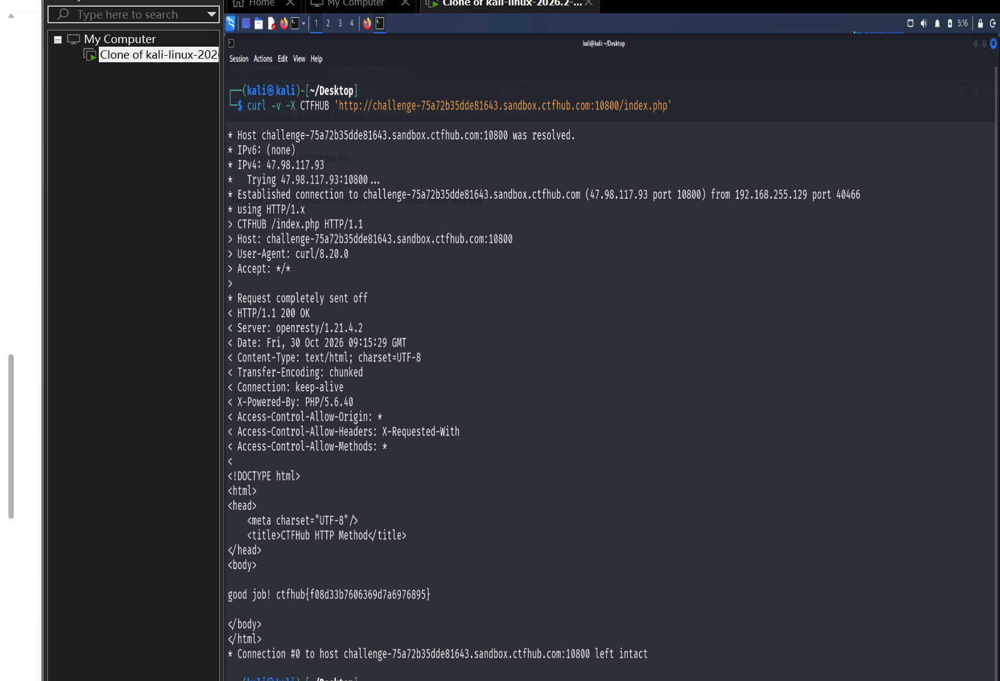

# WP：请求方式

> **CTFHub 路径**：技能树 → Web → Web 前置技能 → HTTP 协议 → 请求方式
> **任务**：按题目要求使用指定的 HTTP 方法访问目标，拿到 flag。
> **提示**：浏览器地址栏默认发送 GET 请求。用 Burp Repeater 修改请求行中的方法，或者用 `curl -X` 复现。
> **截图要求**：优先使用 Burp Repeater，截图中要能看到修改后的请求行（方法 + 路径）和响应中的 flag；如果 Burp 无法启动，可以用 `curl -X` 的方法修改截图代替，并在 WP 中说明原因。只有浏览器普通 GET 访问不算完成。

---

## 题目信息

| 项目 | 内容 |
| --- | --- |
| 环境地址 | http://challenge-75a72b35dde81643.sandbox.ctfhub.com:10800/index.php |
| Flag | ctfhub{f08d33b760636d7fa6976895} |

## 解题过程

先在 Kali 浏览器里正常访问靶场 `index.php`，页面上写着 `HTTP Method is GET`，然后是一句 `Use CTF**B Method, I will give you flag.`，还补了一行 hint：如果拿到「HTTP Method Not Allowed」就去请求 `index.php`。`CTF**B` 是平台把中间两位打码了，结合题目名能看出它要的是 `CTFHUB` 这个方法。浏览器地址栏只会发 GET，所以在页面上怎么点都不会有结果。

这题要求截图里能看到修改后的请求行，所以我没在浏览器里硬凑，直接在 Kali 终端用 curl 发自定义方法。关键是 `-v`：它会把发出去的请求行原样打印出来，正好作为"我确实改过方法"的证据。完整命令是 `curl -v -X CTFHUB 'http://challenge-75a72b35dde81643.sandbox.ctfhub.com:10800/index.php'`。

第一次执行报的是 `Could not resolve host`，原因是我把靶场域名抄错了一个字符、还漏了中间的 `.sandbox.` 段——靶场域名是随机的十六进制串，肉眼抄写很容易出错，后来改成从地址栏复制才成功。

方法改对之后，服务端返回 `HTTP/1.1 200 OK`，响应体从原来那句 `HTTP Method is GET` 变成了 `good job! ctfhub{...}`。**注意状态码前后都是 200**，变的是响应体内容：服务器是先判断方法、再决定输出什么，方法不对时它给提示页，方法对了才给 flag，而不是用 405 拒绝。截图就是用终端这一屏，请求行、状态码、flag 三样都在里面。

## 关键请求/响应

```http
GET /index.php HTTP/1.1
Host: challenge-75a72b35dde81643.sandbox.ctfhub.com:10800

HTTP/1.1 200 OK
Content-Type: text/html

<title>CTFHub HTTP Method</title>
<p>HTTP Method is GET</p>
<p>Use CTF**B Method, I will give you flag.</p>
<p>Hint: If you got 「HTTP Method Not Allowed」 Error, you should request index.php.</p>

--- 在 Repeater 中把方法改成 CTFHUB 后重放 ---

CTFHUB /index.php HTTP/1.1
Host: challenge-75a72b35dde81643.sandbox.ctfhub.com:10800
User-Agent: Mozilla/5.0 (X11; Linux x86_64; rv:115.0) Gecko/20100101 Firefox/115.0
Accept: */*
Connection: close

HTTP/1.1 200 OK
Content-Type: text/html

good job! ctfhub{f08d33b760636d7fa6976895}

--- curl 复现 ---

$ curl -v -X CTFHUB 'http://challenge-75a72b35dde81643.sandbox.ctfhub.com:10800/index.php'
> CTFHUB /index.php HTTP/1.1
> Host: challenge-75a72b35dde81643.sandbox.ctfhub.com:10800
< HTTP/1.1 200 OK
good job! ctfhub{f08d33b760636d7fa6976895}
```

## 原理与复盘

方法在 HTTP 报文的**请求行**里，是最开头那个词：`方法 路径 HTTP/1.1`，方法在最前面、紧跟着是请求目标和协议版本。

标准里 GET/POST/PUT/DELETE 这些是"约定俗成"的语义，但语法上方法就是一个 token，服务器完全可以自己定义一个叫 `CTFHUB` 的方法并只对它返回 flag。这说明"浏览器只能发 GET/POST"只是前端行为，不是协议限制——绕过手段就是直接构造报文（Burp）或用 `curl -X`。真实场景里限制方法应该靠服务端白名单（比如只允许 GET/POST，其余返回 405），而不是指望客户端老实。

---

## 截图



> 可以在这份 WP 中另加过程截图；检查时只看指定图片，额外图片不检查。
