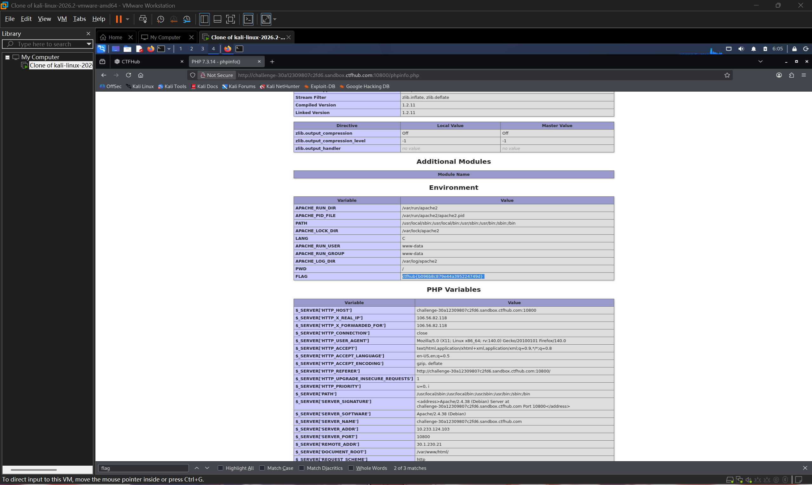

# WP：PHPINFO

> **CTFHub 路径**：技能树 → Web → 信息泄露 → PHPINFO
> **任务**：在 phpinfo 页面中找到 flag，并观察它泄露了哪些信息。
> **提示**：phpinfo 会输出大量 PHP 和服务器配置。用浏览器的查找功能搜索关键字，同时留意页面暴露的路径、版本、环境变量等信息。
> **截图要求**：能看到 phpinfo 页面、你搜索/定位到的 flag，以及至少一处敏感信息。

---

## 题目信息

| 项目 | 内容 |
| --- | --- |
| 环境地址 | http://challenge-30a12309807c2fd6.sandbox.ctfhub.com:10800/phpinfo.php |
| Flag | ctfhub{b096b8c879e44a395224749d} |

## 解题过程

开启题目后，页面给了一个 `/phpinfo.php` 链接，点开就是一整页 phpinfo 输出——紫色表头、几十个分区，从 `PHP Version`、`System`、`Build Date` 一直列到 `environment`、`PHP Variables`，没有任何导航。

我先看了最上面的版本信息：**PHP Version 7.3.14**，运行在 Linux 上；往下翻还能看到 `mysqld` 分区里 `Version 5.0.12-dev - 20150407`，说明这台机器上还装了 MySQL 客户端库。

页面太长，靠滚动找不现实，所以我按 `Ctrl + F` 直接搜 `flag`。浏览器一共命中 2 处，其中一处在 **`Environment` 分区**里，是一行独立的表格项：

```
FLAG    ctfhub{b096b8c879e44a395224749d}
```

它周围全是服务器自己的环境变量（`PWD` 是 `/`、`APACHE_LOG_DIR` 是 `/var/log/apache2`），说明服务端把带 flag 的变量直接塞进了运行环境，而 phpinfo 又把这个环境原样打印了出来。

确认之后我把 flag 提交到题目页面，平台提示正确（题目状态变为「已解出」）。顺便记下了页面同时暴露的东西：PHP 版本 7.3.14、`mysqld` 客户端版本 5.0.12-dev、各类绝对路径与一长串环境变量——这些东西本来都只应该留在服务器本地。

## 关键请求/响应

```http
GET /phpinfo.php HTTP/1.1
Host: challenge-30a12309807c2fd6.sandbox.ctfhub.com:10800
User-Agent: Mozilla/5.0 (X11; Linux x86_64; rv:115.0) Gecko/20100101 Firefox/115.0

HTTP/1.1 200 OK
Content-Type: text/html; charset=UTF-8

--- Environment 分区里定位到的 flag 行 ---

<tr><td class="e">APACHE_LOG_DIR </td><td class="v">/var/log/apache2 </td></tr>
<tr><td class="e">PWD </td><td class="v">/ </td></tr>
<tr><td class="e">FLAG </td><td class="v">ctfhub{b096b8c879e44a395224749d} </td></tr>

--- 同页泄露的其他敏感信息 ---

PHP Version	7.3.14
mysqld	Version 5.0.12-dev - 20150407
APACHE_LOG_DIR	/var/log/apache2
```

## 原理与复盘

phpinfo 是 PHP 自带的调试函数，输出的是**响应体**里的信息；它本身不处理请求参数，所以这题的攻击面在服务端"不该对外输出的东西被输出了"。

它一次会泄露 PHP 与内核版本、编译参数、绝对路径、环境变量、已加载扩展等。对攻击者来说这些是现成的情报：版本号能直接对应到已知 CVE，绝对路径方便后续的任意文件读取或上传路径拼接，环境变量里常常躺着数据库口令和密钥。生产环境应当把 phpinfo、phpMyAdmin 这类调试页面删掉或限制来源 IP。

---

## 截图



> 可以在这份 WP 中另加过程截图；检查时只看指定图片，额外图片不检查。
