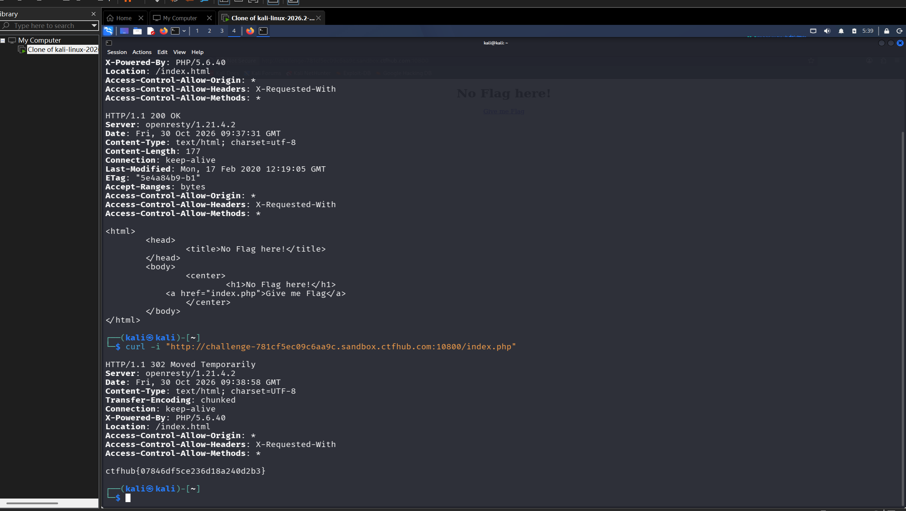

# WP：302 跳转

> **CTFHub 路径**：技能树 → Web → Web 前置技能 → HTTP 协议 → 302 跳转
> **任务**：观察 302 重定向，按题目提示找到 flag。
> **提示**：浏览器通常会自动跟随 302，所以你可能只看到最终页面。打开 DevTools 的 Network 面板（勾选 Preserve log）或 Burp，查看原始响应中的 `302` 状态码和 `Location` 响应头。
> **截图要求**：能看到 302 状态码和/或 `Location` 响应头，以及最终的 flag。只截最终页面、没有 302 证据的截图不合格。

---

## 题目信息

| 项目 | 内容 |
| --- | --- |
| 环境地址 | http://challenge-781cf5ec09c6aa9c.sandbox.ctfhub.com:10800/index.php |
| Flag | ctfhub{07846df5ce236d18a240d2b3} |

## 解题过程

打开靶场根路径，页面只有一行 `No Flag here!` 和一个 `Give me Flag` 链接。看页面源码，链接指向 `index.php`，而根路径本身返回的是一个 177 字节的静态 `index.html`。也就是说这题的结构是 `index.html` ↔ `index.php` 互相指来指去。

我先在浏览器里点了一下 `Give me Flag`，页面又回到同样的 `No Flag here!`，什么都没有。于是改用 `curl -iL` 请求 `index.php`，`-L` 让 curl 跟着跳、`-i` 打印每一跳的响应头。输出里确实看到了完整的链路：先是 `HTTP/1.1 302 Moved Temporarily` 加 `Location: /index.html`，然后是第二跳的 `HTTP/1.1 200 OK`，内容又是那个 `No Flag here!` 页面——**换句话说这是个环路，跟过去不会有终点**。

关键在下一步：我把 `-L` 去掉，只发 `curl -i`。这时输出就只有那一跳的 302，`Location: /index.html` 照旧，但**响应体里多出了一行 flag**。原来这题把 flag 放在了 302 响应的 body 里，而客户端一旦开启自动跟随，就会把中间这一跳的响应体丢掉，只留最后的 200 页面。之前 `-iL` 看不到 flag 不是因为它不存在，而是被"跟随"这个动作吃掉了。

所以这题的解法就是**关掉自动跟随、老老实实看第一跳的完整报文**，而浏览器天然做不到这一点（它一定跟随），必须用 curl 或 Burp 这类工具。

## 关键请求/响应

```http
$ curl -i "http://challenge-781cf5ec09c6aa9c.sandbox.ctfhub.com:10800/index.php"

HTTP/1.1 302 Moved Temporarily
Server: openresty/1.21.4.2
Date: Fri, 30 Oct 2026 09:38:24 GMT
Content-Type: text/html; charset=UTF-8
Transfer-Encoding: chunked
Connection: keep-alive
X-Powered-By: PHP/5.6.40
Location: /index.html
Access-Control-Allow-Origin: *
Access-Control-Allow-Headers: X-Requested-With
Access-Control-Allow-Methods: *

ctfhub{07846df5ce236d18a240d2b3}

--- 对照组：根路径拿到的是静态页，没有 flag ---

$ curl -i "http://challenge-781cf5ec09c6aa9c.sandbox.ctfhub.com:10800/"

HTTP/1.1 200 OK
Server: openresty/1.21.4.2
Content-Type: text/html; charset=utf-8
Content-Length: 177
Last-Modified: Mon, 17 Feb 2020 12:19:05 GMT
ETag: "5e4a84b9-b1"

<html><head><title>No Flag here!</title></head><body>
<center><h1>No Flag here!</h1><a href="index.php">Give me Flag</a></center>
</body></html>

--- 加了 -L 之后：302 的响应体被丢弃，只剩第二跳 ---

$ curl -iL "http://challenge-781cf5ec09c6aa9c.sandbox.ctfhub.com:10800/index.php"

HTTP/1.1 302 Moved Temporarily
Location: /index.html
（此处本应有 flag，但被跟随动作丢掉了）
HTTP/1.1 200 OK
Content-Length: 177
（又是 No Flag here!）
```

## 原理与复盘

位置在**状态行 + 响应头**：200 是状态行后直接跟响应体，浏览器原地渲染；302 的状态行写 `302 Moved Temporarily`，真正的指向信息在 `Location` 响应头里，浏览器读到就再发一次请求过去，中间那一跳的响应体**既不渲染也不保留**。

这题还说明了两件事。一是 **302 并不是"没有响应体"**，规范只要求带 Location，并不禁止带 body，这题就把 flag 放在了 302 的 body 里——所以"302 一定是空的"是个常见误解，判断依据应该是实际报文而不是印象。二是 **Location 不保证指向终点**，这题指向的 `index.html` 又链回 `index.php`，形成环路，无限跟随也没有结果。

实践上的结论：要看到重定向的全貌，就得用不自动跟随的客户端（curl 不加 `-L`、Burp 的 Repeater）逐跳看；想一次看完整条链路可以用 `-iL`，但要清楚它会丢弃中间跳的响应体。

---

## 截图



> 可以在这份 WP 中另加过程截图；检查时只看指定图片，额外图片不检查。
