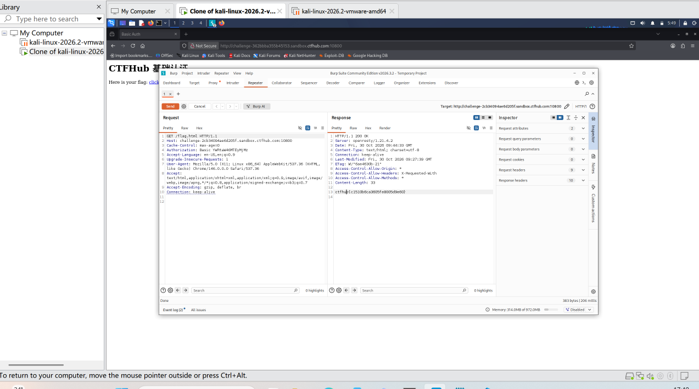

# WP：基础认证

> **CTFHub 路径**：技能树 → Web → Web 前置技能 → HTTP 协议 → 基础认证
> **任务**：按题目提示完成 HTTP Basic 认证，拿到 flag。
> **提示**：观察 `401 Unauthorized` 响应和 `WWW-Authenticate: Basic` 响应头。Basic 认证把 `用户名:密码` 做 Base64 编码后放在 `Authorization` 请求头里，Base64 不是加密。
> **截图要求**：能看到 `Authorization: Basic ...` 请求头，以及认证成功后的 flag 或页面。

---

## 题目信息

| 项目 | 内容 |
| --- | --- |
| 环境地址 |  http://challenge-2cb34094ae6d205f.sandbox.ctfhub.com:10800/|
| Flag | ctfhub{c1510b6ca3605fe8005d9e60}|


## 解题过程

首次访问目标地址时，服务器返回401 Unauthorized状态码，同时响应头中带有 WWW-Authenticate: Basic ，说明该页面启用了HTTP Basic基础认证，需要提供合法的用户名和密码才能访问资源。
我使用Burp Suite抓取认证请求包，将Authorization头中Base64编码的部分设置为爆破点，用户名固定为admin，加载密码字典，配置载荷处理规则自动拼接 admin: 并进行Base64编码。
启动Intruder爆破后，观察返回状态码，绝大多数请求返回401代表密码错误，找到状态码为200 OK的请求，代表认证通过。
查看该请求的响应内容，成功拿到Flag，完成这道基础认证题目。

## 关键请求/响应

```http
请求包
GET /flag.html HTTP/1.1

Host: challenge-2cb34094ae6d205f.sandbox.ctfhub.com:10800

Cache-Control: max-age=0

Authorization: Basic YWRtaW46MTEyMjMz


Accept-Language: en-US,en;q=0.9

Upgrade-Insecure-Requests: 1

User-Agent: Mozilla/5.0 (X11; Linux x86_64) AppleWebKit/537.36 (KHTML, like Gecko) Chrome/146.0.0.0 Safari/537.36

Accept: text/html,application/xhtml+xml,application/xml;q=0.9,image/avif,image/webp,image/apng,*/*;q=0.8,application/signed-exchange;v=b3;q=0.7

Accept-Encoding: gzip, deflate, br

Connection: keep-alive
响应包
HTTP/1.1 200 OK

Server: openresty/1.21.4.2

Date: Fri, 30 Oct 2026 09:44:33 GMT

Content-Type: text/html; charset=utf-8

Connection: keep-alive

Last-Modified: Fri, 30 Oct 2026 09:27:39 GMT

ETag: W/"6ae4630b-21"

Access-Control-Allow-Origin: *

Access-Control-Allow-Headers: X-Requested-With

Access-Control-Allow-Methods: *

Content-Length: 33


ctfhub{c1510b6ca3605fe8005d9e60}


```

## 原理与复盘
Base64并不是加密算法，只是一种编码方式，没有保密性，可以直接解码还原原始内容。Authorization请求头里存放的是用户名:密码拼接后的字符串经过Base64编码得到的结果，服务器收到后解码，核对账号密码来完成HTTP基础认证。

---

## 截图



> 可以在这份 WP 中另加过程截图；检查时只看指定图片，额外图片不检查。

