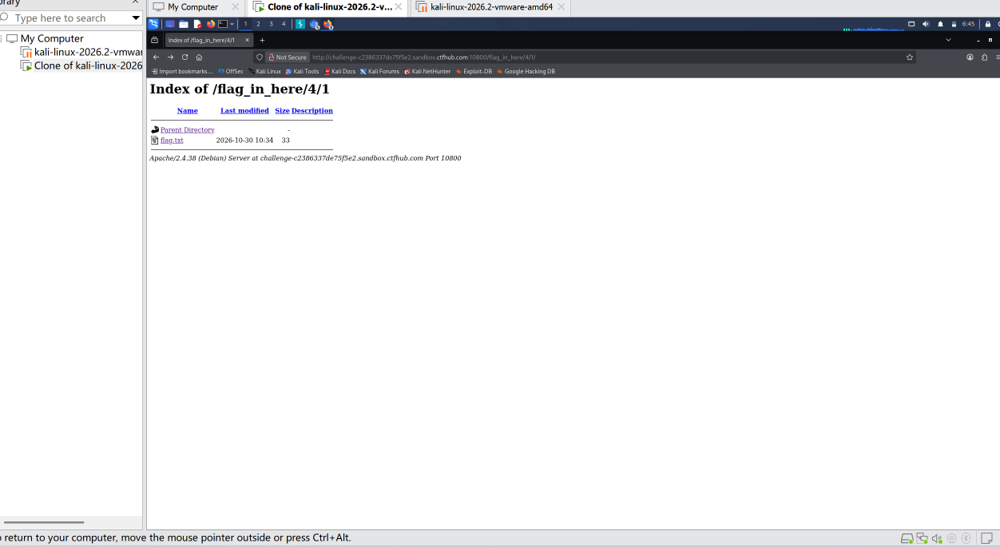

# WP：目录遍历

> **CTFHub 路径**：技能树 → Web → 信息泄露 → 目录遍历
> **任务**：按题目页面提示找到 flag。
> **提示**：注意页面给出的路径和 URL；目录列表本身就是一种信息泄露。只在题目环境内点击和访问，不要使用扫描器扫描其他地址。
> **截图要求**：能看到题目环境地址（或题目名称）、你访问的目录/路径，以及最终的 flag。

---

## 题目信息

| 项目 | 内容 |
| --- | --- |
| 环境地址 | http://challenge-c2386337de75f5e2.sandbox.ctfhub.com:10800 /|
| Flag | ctfhub{2792b2c4d3747ff84793793a}|
 

## 解题过程

打开靶场链接后，页面展示了目录索引。我逐层访问子文件夹，依次尝试各个目录，最终在  /flag_in_here/4/1/  路径下找到  flag.txt 。点击这个文件，页面成功显示flag。这个实验说明开启目录索引会暴露服务器内部文件结构。

## 关键请求/响应

```http
GET /flag_in_here/4/1/flag.txt HTTP/1.1
Host: challenge-c2386337de75f5e2.sandbox.ctfhub.com:10800
本题不需要修改请求。
```

## 原理与复盘

目录列表信息放在HTTP响应报文里返回。服务器开启目录索引功能时，会直接展示文件夹内的文件，造成路径、文件名等敏感信息泄露。

---

## 截图



> 可以在这份 WP 中另加过程截图；检查时只看指定图片，额外图片不检查。

