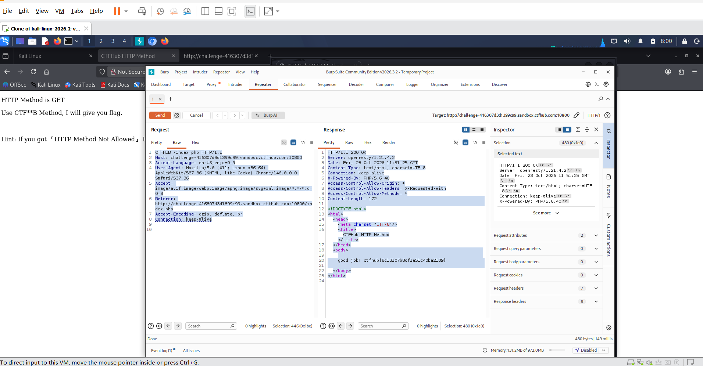

# WP：请求方式

> **CTFHub 路径**：技能树 → Web → Web 前置技能 → HTTP 协议 → 请求方式
> **任务**：按题目要求使用指定的 HTTP 方法访问目标，拿到 flag。
> **提示**：浏览器地址栏默认发送 GET 请求。用 Burp Repeater 修改请求行中的方法，或者用 `curl -X` 复现。
> **截图要求**：优先使用 Burp Repeater，截图中要能看到修改后的请求行（方法 + 路径）和响应中的 flag；如果 Burp 无法启动，可以用 `curl -X` 的方法修改截图代替，并在 WP 中说明原因。只有浏览器普通 GET 访问不算完成。

---

## 题目信息

| 项目 | 内容 |
| --- | --- |
| 环境地址 | http://challenge-418307d3d1399c99.sandbox.ctfhub.com:10800 |
| Flag | ctfhub{8c13107b9cf1e51c40ba2109} |

## 解题过程
首先在浏览器访问题目环境地址，用Burp Suite抓包，捕获浏览器默认发出的GET请求。然后把数据包发送到Repeater模块，将请求行最前面的请求方法GET修改为CTFHUB。点击Send发送修改后的数据包，服务器响应内容中返回flag。普通浏览器只能发送GET请求，无法直接使用自定义请求方法，所以必须借助Burp或者curl修改请求方法才能拿到flag。


## 关键请求/响应

```http
CTFHUB /index.php HTTP/1.1
Host: challenge-418307d3d1399c99.sandbox.ctfhub.com:10800
User-Agent: Mozilla/5.0 (X11; Linux x86_64; Linux x86_64) AppleWebKit/537.36 (KHTML, like Gecko) Chrome/146.0.0.0 Safari/537.36
Accept: text/html,application/xhtml+xml,application/xml;q=0.9,image/avif,image/webp,image/apng,*/*;q=0.8

HTTP/1.1 200 OK
Server: openresty/1.21.4.2
Content-Type: text/html; charset=UTF-8

响应体：
good job! ctfhub{8c13107b9cf1e51c40ba2109}
```

## 原理与复盘
HTTP请求行由请求方法、请求路径、协议版本三部分组成。请求方法放在请求行最开头，用来告诉服务器本次想要执行什么操作。本题就是通过自定义非标准请求方法来完成验证。


---

## 截图



> 可以在这份 WP 中另加过程截图；检查时只看指定图片，额外图片不检查。

