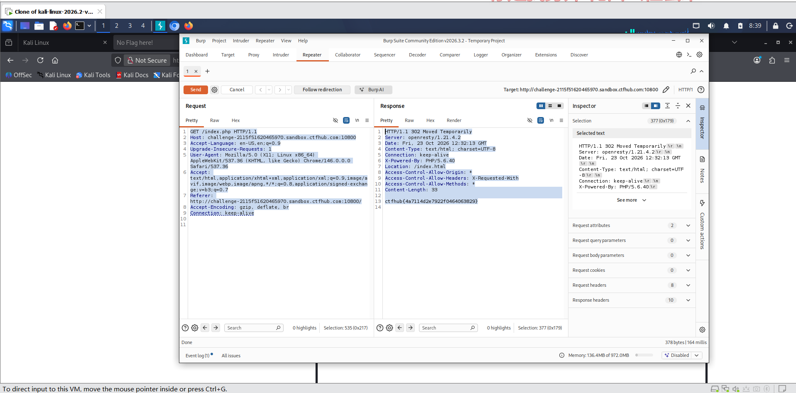

# WP：302 跳转

> **CTFHub 路径**：技能树 → Web → Web 前置技能 → HTTP 协议 → 302 跳转
> **任务**：观察 302 重定向，按题目提示找到 flag。
> **提示**：浏览器通常会自动跟随 302，所以你可能只看到最终页面。打开 DevTools 的 Network 面板（勾选 Preserve log）或 Burp，查看原始响应中的 `302` 状态码和 `Location` 响应头。
> **截图要求**：能看到 302 状态码和/或 `Location` 响应头，以及最终的 flag。只截最终页面、没有 302 证据的截图不合格。

---

## 题目信息

| 项目 | 内容 |
| --- | --- |
| 环境地址 | http://challenge-2115f520f485970.sandbox.ctfhub.com:10800 |
| Flag | ctfhub{e71144e2792106b4609890b} |

## 解题过程

我用浏览器直接访问靶场地址 /index.php，页面几乎瞬间就变成了 index.html 的内容，完全没有察觉中间有跳转，这就是浏览器自动跟随了 302 重定向。为了看到原始响应，我把请求放到 Burp 的 Repeater 里手动发送，这次没有自动跳转，直接看到了服务器的原始响应：状态行是 302 Moved Temporarily，响应头里有 Location: /index.html。更关键的是，这个 302 响应自己的响应体里就藏着 flag，浏览器平时把它跳过所以我们看不见。这让我体会到 302 并不是"没有内容"，浏览器只是帮忙跳过去了。

## 关键请求/响应

```http
GET /index.php HTTP/1.1
Host: challenge-2115f520f485970.sandbox.ctfhub.com:10800

HTTP/1.1 302 Moved Temporarily
Server: openresty/1.21.4.2
Location: /index.html
Content-Type: text/html; charset=UTF-8

响应体：
ctfhub{e71144e2792106b4609890b}
```

## 原理与复盘

302 和 200 在浏览器里的表现完全不同：200 直接渲染响应体，而 302 浏览器会读取 Location 头立刻发起新请求，用户基本感知不到中间过程。所以调试时必须用 Burp 或 DevTools（勾选 Preserve log）才能看到 302 的原始报文。这道题说明跳转响应里同样可以携带数据，只看"最终页面"会漏掉很多信息。

---

## 截图



> 可以在这份 WP 中另加过程截图；检查时只看指定图片，额外图片不检查。

