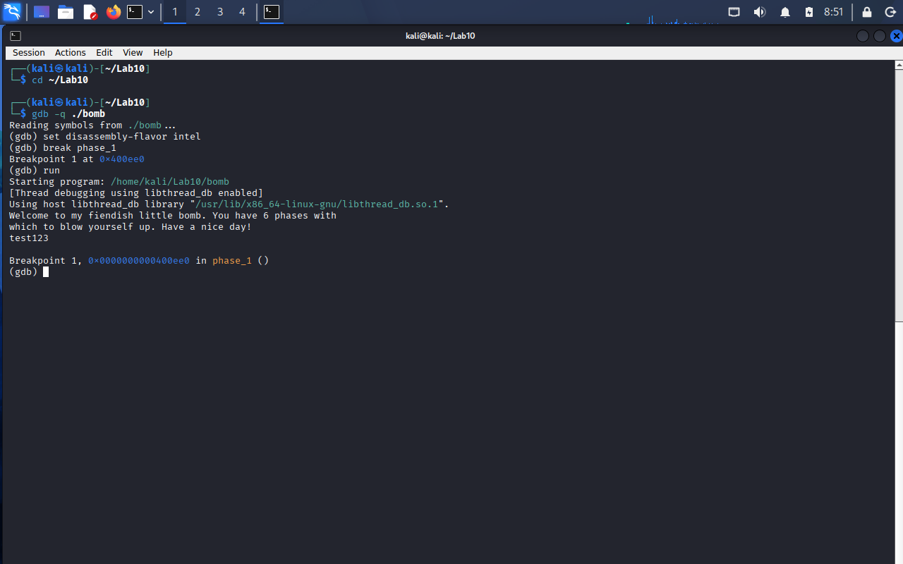
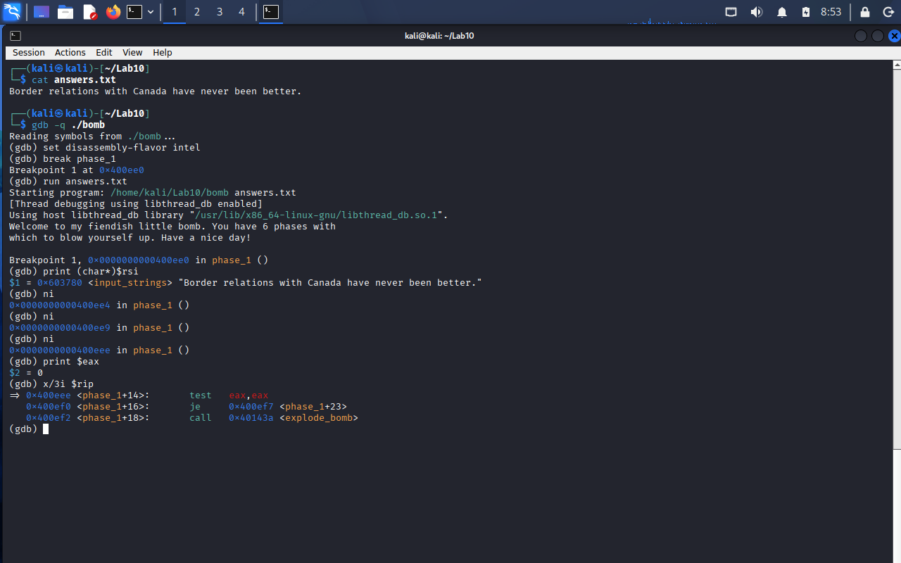
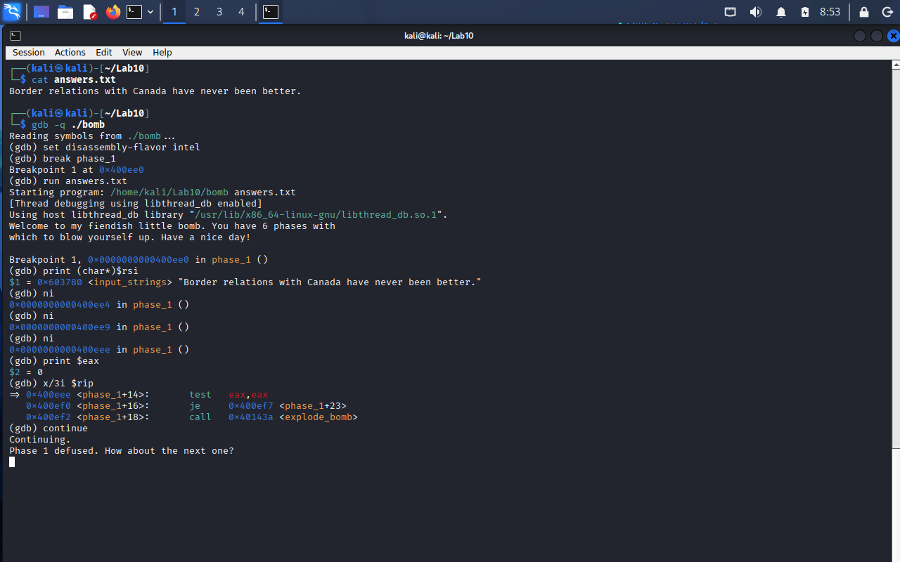

# Lab10　CS:APP Bomb Lab 第一关

实验九里，你在 `bomb.c` 中读到了 `phase_1(input);`。现在轮到你真正运行并调试它：在 x86-64 Kali 中用 GDB 调试课程提供的 `bomb`，找出能让第一关正常返回的一行输入，并用自己的调试记录解释原因。

在动手调试之前，先确认两件事：**可执行文件 `bomb` 的整体结构是什么**，以及**这个 C 程序怎样从键盘或文件里读入文字**。最后以 GDB 中成功输出第一关通过提示 `Phase 1 defused. How about the next one?` 作为本实验的通关标志。

## 一、先看懂 `bomb.c` 的结构与两种输入方式

### 1.1 `bomb` 与 `bomb.c` 的关系及大体结构

课程仓库的 `homework/Lab10/` 目录下提供了两个文件：

- `bomb`：已经编译好的 Linux x86-64 可执行程序（[CS:APP 官方 Bomb Lab 自学版](https://csapp.cs.cmu.edu/3e/labs.html)），可以直接在 Kali 中运行和调试。
- [bomb.c](../../homework/Lab10/bomb.c)：与实验九相同的主程序 C 源码（中文注释版），这里再放一份，方便你调试时随时对照。

可执行文件 `bomb` 正是由 `bomb.c`（以及它通过 `#include "phases.h"` 和 `#include "support.h"` 引入、但**未向你公开源码**的关卡实现文件）共同编译链接生成的。因此，你可以直接读 `bomb.c` 看懂整个程序的主框架，但看不到 `phase_1` 内部的 C 代码——这也是本次实验必须用 GDB 反汇编 `phase_1` 的原因。

虽然实验九已经读过 `bomb.c`，动手前请再对照它的三段式大体结构，心里有张地图：

1. **确定输入来源（`main` 开头）**：检查启动程序时有没有在命令后面跟文件名，决定后面从键盘读还是从文件读，结果保存在 `infile` 里。
2. **初始化并打印欢迎语**：调用 `initialize_bomb()`，随后打印两行欢迎语：
   ```text
   Welcome to my fiendish little bomb. You have 6 phases with
   which to blow yourself up. Have a nice day!
   ```
3. **六个阶段依次推进**：第一关到第六关采用完全相同的套路——读入一行文字、交给对应关卡检查、记录通过、打印过关提示。其中第一关在 `bomb.c` 中就是下面这四行：
   ```c
   input = read_line();             /* 读入一行。 */
   phase_1(input);                  /* 用这一行输入运行第一阶段。 */
   phase_defused();                 /* 记录通过。 */
   printf("Phase 1 defused. How about the next one?\n");
   ```
   一旦第一关通过、打印完提示，程序会立刻继续执行下一行 `input = read_line();`，准备接收第二关的输入。而如果 `phase_1(input)` 判定你的输入不对，它会在函数内部直接引爆炸弹并结束程序，永远不会返回到 `main` 执行后面的 `printf`。

### 1.2 C 程序怎样从键盘或文件读入文字

前面几次实验（Lab7～Lab9）里，字符串和数据都是**直接写死在 C 源码里**的（例如 `char input[] = "Hi";`），想换一组测试文字就得修改 `.c` 文件再重新用 `gcc` 编译。

但现实中的程序大多要在**运行过程中**接收外部文字，`bomb` 也不需要、也不能让你重新编译。它支持两种把外部文字送进 C 程序的方式，正好对应 `bomb.c` 开头的 `if / else if`：

#### 方式一：从键盘输入字符（标准输入 `stdin`）

- **怎么触发**：直接启动程序、后面不加任何参数——在 Kali 终端里是 `./bomb`，在 GDB 里是直接敲 `run`。
- **代码里发生了什么**：命令行参数个数 `argc` 等于 `1`（只包含程序名本身），于是 `bomb.c` 执行 `infile = stdin;`。`stdin`（standard input，标准输入）默认连着你的终端键盘。
- **运行时的现象**：程序打印欢迎语后执行 `input = read_line();`，此时程序会**停住等待你敲键盘**。
  - 注意观察屏幕：此刻既没有 Kali 终端提示符，也没有 `(gdb)` 提示符，光标只是停在空行上。这表示**正在等程序输入**，不要在这里敲 `next`、`disassemble` 等 GDB 命令。
  - 你在键盘上打出一行字符并按下 **回车键（Enter）**，整行文字就会被 `read_line()` 读进内存，末尾自动补上字符串结束符 `'\0'`，并把首字符地址赋给 `input`，随后才进入 `phase_1(input)`。

#### 方式二：直接从文件读取文字（命令行参数 + `fopen`）

- **为什么要用文件**：调试时经常需要反复重新运行程序。如果推断出的通关文字较长，每次靠键盘重敲既麻烦又容易多打空格或敲错字母。把文字提前存进一个纯文本文件，让程序自己去读，既省事又准确。
- **怎么触发**：在程序名后面跟一个文件名作为参数——在终端里是 `./bomb answers.txt`，**在 GDB 里则是进入 `gdb -q ./bomb` 之后输入 `run answers.txt`**（`run` 后面写的内容，会被 GDB 当作命令行参数传给程序）。
- **代码里发生了什么**：此时 `argc` 等于 `2`，其中 `argv[0]` 是程序名 `./bomb`，`argv[1]` 是字符串 `"answers.txt"`。`bomb.c` 执行：
  ```c
  infile = fopen(argv[1], "r")
  ```
  `fopen(..., "r")` 的意思是“以只读方式打开这个文本文件”。如果文件名拼错了或文件不在当前目录，`fopen` 会失败，程序打印 `Error: Couldn't open ...` 并直接退出。
- **运行时的现象**：文件打开成功后，执行 `input = read_line();` 时程序**不会停下来等你敲键盘**，而是自动把文件里的**第一行文字**读进内存交给 `phase_1(input)`。
- **文件读完后会怎样**：请特别留意 `bomb.c` 里的注释——当 `answers.txt` 里只写了一行（第一关的答案）时，第一关通过后，第二关再次调用 `read_line()`，发现文件已经读到末尾，程序就会**自动切换回从键盘（`stdin`）等待第二行输入**。这也是为什么第一关通关后程序会停在那里等输入，而不是直接退回 `(gdb)`。

| 启动方式（GDB 中） | `argc` | `argv[1]` | `infile` 指向 | `read_line()` 从哪里读第一行 |
| :--- | :--- | :--- | :--- | :--- |
| `run` | `1` | 无 | `stdin` | 停下来等你从键盘输入并按回车 |
| `run answers.txt` | `2` | `"answers.txt"` | 打开的 `answers.txt` | 自动读取文件第一行；文件读完后切回键盘 |

## 二、让程序停在第一关

将课程仓库中的 `homework/Lab10/bomb` 复制到 Kali 的个人工作目录（例如 `~/Lab10/`；你也可以把 `bomb.c` 一并复制过去方便对照阅读）。

在存放 `bomb` 的目录打开终端，执行：

```bash
uname -m
chmod +x bomb
gdb -q ./bomb
```

第一条命令应显示 `x86_64`。进入 GDB 后执行：

```gdb
set disassembly-flavor intel
break phase_1
run
```

此时使用的是**方式一（键盘输入）**：欢迎语出现后，光标停在空行等待你输入，不会出现 `(gdb)` 提示符。请随便输入一行你自己容易辨认的测试文字（例如 `test123`）并按回车。

程序先通过 `read_line()` 把这行文字读入内存，紧接着调用 `phase_1(input)` 并命中刚才设好的断点，屏幕重新出现 `(gdb)` 提示符。此时用实验九学过的 `disassemble phase_1` 查看第一关的机器指令，找出它调用的比较函数，以及比较函数返回后决定走向的条件跳转指令。

## 三、推断并验证输入

### 3.1 观察参数与分支，推断通关文字

先观察你刚从键盘输入的文字和程序拿来比较的内容，再预测什么情况下第一关会正常返回。遇到困难时，先对照下面两个问题思考：

1. 实验九中，两个字符串交给同一个函数时，你是在哪个时刻查看参数寄存器（`rdi`、`rsi`），才看清每个地址分别指向哪段文字的？
2. 比较函数返回后，返回值放在哪个寄存器里？紧跟其后的哪条指令检查了这个结果？沿条件跳转的两条路径各往下读几行，哪一条路通向 `explode_bomb`（爆炸），哪一条路能正常 `ret` 回到 `main`？

### 3.2 写入 `answers.txt` 并用文件输入验证

得出判断后，采用**方式二（从文件读取）**来验证：在 Kali 存放 `bomb` 的同一目录下新建纯文本文件 `answers.txt`，把你推断出的一行文字原样写入第一行并保存。

- 可以另开一个 Kali 终端标签页，在 `bomb` 所在目录用 `nano answers.txt` 输入并保存（或用 `printf '%s\n' '你推断的文字' > answers.txt` 写入，再用 `cat answers.txt` 核对）。
- 注意：**不要**在文件里多加外层双引号，也不要在行首或行尾多留空格，标点与大小写须与程序中的对照文字完全一致。

回到 GDB 会话，用以下命令重新运行程序（若 GDB 询问 `Start it from the beginning? (y or n)`，输入 `y` 并回车）：

```gdb
run answers.txt
```

这次不需要手敲测试文字，程序会自动读入 `answers.txt` 的第一行，并再次停在 `phase_1` 断点处。使用 `ni` 单步执行到比较函数返回之后、条件跳转之前的位置，查看用来决定分支的寄存器读数和条件跳转指令，核对自己的预测（截下**图 2**），然后输入 `continue` 让程序继续运行。

### 3.3 确认实验通关的样子

执行 `continue` 之后，请对照下面两种结果判断自己是否真正通关：

- **通关的样子（本实验完成标志）**：
  终端中**没有**出现任何爆炸提示，而是紧接着打印出 `bomb.c` 第 65 行的过关提示：
  ```text
  Phase 1 defused. How about the next one?
  ```
  **注意**：看到这行字之后，终端光标会停在下一行空白处，**不会立刻退回 `(gdb)` 提示符**——这不是卡死了，而是因为 `answers.txt` 只有一行，第一关已经顺利拆解，程序现在正执行到第二关的 `read_line()`，切换回从键盘等你输入第二关的文字。
  - 看到 `Phase 1 defused. How about the next one?` 停在这里，就是本实验**通关的完整画面**，直接截取**图 3**即可，不必继续解第二关（也不要随手回车以免触发第二关爆炸）。
  - 截完图后，按 `Ctrl+C` 暂停程序回到 `(gdb)` 提示符，输入 `quit`（询问是否结束运行中的程序时输入 `y`）即可退出 GDB。

- **未通关（炸弹引爆）的样子**：
  如果 `answers.txt` 中的文字有误（例如大小写不对、漏掉标点或多了空格），`phase_1` 会跳进 `explode_bomb`，终端会打印：
  ```text
  BOOM!!!
  The bomb has blown up.
  ```
  随后程序直接退出。这是本地自学版炸弹，引爆不会扣分也不会影响系统；请重新核对 `answers.txt` 的内容和你在 GDB 中看到的对照字符串，修改后再执行 `run answers.txt` 验证，直到看到 `Phase 1 defused. How about the next one?`。

## 四、本人实验记录

把本手册复制到 `学号姓名/Lab10/Lab10.md`，保留模板，在下列位置填写本人的观察，并附上三张本人在 Kali 中操作 GDB 的截图。

姓名及 10 位学号：王思涵，2026010037

**判断依据**　用两三句话说明两项比较数据分别来自哪里，写出自己观察到的比较结果和条件跳转指令，并说明该次执行为什么能通过。用“本人输入”和对照数据的来源描述字符串即可，完整通关文字留在本地。

> 两项比较数据分别来自：一项是本人输入——第一次从键盘敲的测试文字、以及后来 `answers.txt` 的第一行，由 `read_line()` 读进 `input_strings`（截图里 `$rsi` 指向 `0x403780 <input_strings>`）；另一项是 `phase_1` 反汇编第二行 `mov esi,0x402400` 指定的只读数据区字符串，在 GDB 里用 `x/s` 读出，是程序内置的对照文字。
>
> `x/3i $rip` 显示比较函数 `strings_not_equal` 返回后紧跟的三条指令：`test eax,eax`、`je 0x400ef7 <phase_1+23>`、`call 0x40143a <explode_bomb>`。输入测试文字时 `print $eax` 得到非 0，`test` 后 ZF=0，`je` 不跳，顺序执行到 `explode_bomb`；换成 `answers.txt` 里的对照文字后，`print $eax` 读到 `$2 = 0`，`test eax,eax` 使 ZF=1，`je` 直接跳到 `phase_1+23` 的 `add rsp,0x8`，跳过 `explode_bomb` 并 `ret` 回 `main`，所以这次执行能通过（完整通关文字留在本地 `answers.txt` 里）。

**图 1　命中断点**　第一次从键盘输入测试文字后，截下你输入的测试文字和 GDB 停在 `phase_1` 的断点提示。



**图 2　判断分支**　用 `run answers.txt` 重新运行。比较函数返回后，截下用于解释分支的一项实际读数，以及据此决定走向的条件跳转指令。



**图 3　验证通关**　截下 `continue` 命令和随后出现的第一关通关提示 `Phase 1 defused. How about the next one?`（不能包含 `BOOM!!!`）。



## 五、提交

在个人目录中提交实验报告和三张截图。`bomb`、`bomb.c` 和 `answers.txt` 留在自己的实验环境，无需提交到个人目录。

```text
学号姓名/
└── Lab10/
    ├── Lab10.md
    └── imgs/
        ├── lab10_breakpoint.png
        ├── lab10_branch.png
        └── lab10_phase1.png
```

截图使用 PNG 格式，单张不超过 5 MB。提交前在 Markdown 预览中确认图片可见。PR 标题为 `[学号姓名]Lab10作业提交`。

截止时间为北京时间 **2026 年 12 月 4 日 24:00**（12 月 5 日 00:00）。
