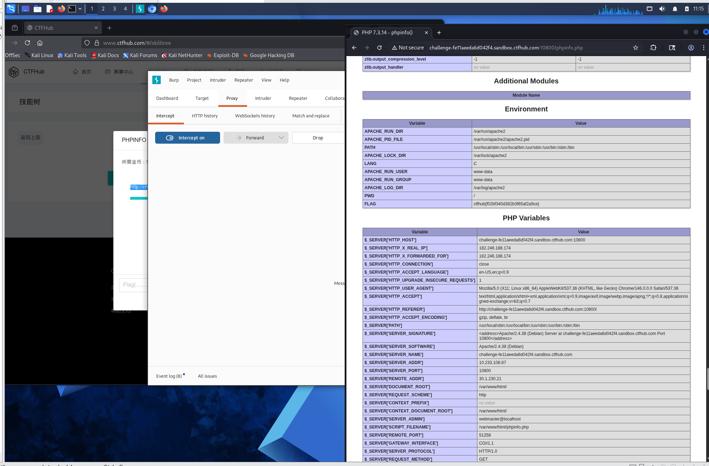

# WP：PHPINFO

> **CTFHub 路径**：技能树 → Web → 信息泄露 → PHPINFO
> **任务**：在 phpinfo 页面中找到 flag，并观察它泄露了哪些信息。
> **提示**：phpinfo 会输出大量 PHP 和服务器配置。用浏览器的查找功能搜索关键字，同时留意页面暴露的路径、版本、环境变量等信息。
> **截图要求**：能看到 phpinfo 页面、你搜索/定位到的 flag，以及至少一处敏感信息。

---

## 题目信息

| 项目 | 内容 |
| --- | --- |
| 环境地址 | http://challenge-fe11eeeda8b92424.sandbox.ctfhub.com:10800/phpinfo.php |
| Flag | ctfhub{f02bf340d382b3f65af2a9ce} |

## 解题过程

开启题目后访问给出的 `/phpinfo.php`，页面直接吐出 phpinfo 的输出，标题是 `PHP Version 7.3.14`。这个页面信息量很大，我第一反应是用浏览器的查找功能（`Ctrl+F`）搜关键字 `flag`，但正文里没有；于是换用 `ctfhub` 作为关键字，一下定位到 Environment 区块里有一个环境变量叫 `FLAG`，它的值就是 `ctfhub{f02bf340d382b3f65af2a9ce}`，复制回题目页面提交，平台提示正确。

定位 flag 的同时，我也注意到 phpinfo 页把一大堆敏感信息原样暴露了出来：`SERVER_SOFTWARE` 写着 `Apache/2.4.38 (Debian)`，`DOCUMENT_ROOT` 是 `/var/www/html`，`SCRIPT_FILENAME` 是 `/var/www/html/phpinfo.php`，还有 `SERVER_ADDR`（内网 IP）、`PATH` 环境变量、PHP 扩展目录等。也就是说，flag 是通过「环境变量」这个渠道泄露的，而 phpinfo 恰好把环境变量打印了出来。

## 关键请求/响应

```http
GET /phpinfo.php HTTP/1.1
Host: challenge-fe11eeeda8b92424.sandbox.ctfhub.com:10800
User-Agent: Mozilla/5.0 (X11; Linux x86_64) AppleWebKit/537.36 (KHTML, like Gecko) Chrome/146.0.0.0 Safari/537.36
Accept: text/html,application/xhtml+xml,application/xml;q=0.9,*/*;q=0.8

HTTP/1.1 200 OK
Content-Type: text/html; charset=UTF-8

（页面正文节选，来自 phpinfo 输出）
PHP Version 7.3.14
SERVER_SOFTWARE: Apache/2.4.38 (Debian)
DOCUMENT_ROOT: /var/www/html
SCRIPT_FILENAME: /var/www/html/phpinfo.php
SERVER_ADDR: 10.233.90.87
Environment 区块 → FLAG = ctfhub{f02bf340d382b3f65af2a9ce}
```

本题不需要修改任何请求，直接访问题目给的 phpinfo 地址，在返回的 HTML 里搜索即可定位 flag。

## 原理与复盘

phpinfo() 是 PHP 自带的一个调试函数，它会一口气把 PHP 配置、运行环境、请求头、环境变量、模块信息全部打印出来，本意是方便开发者排查问题，但一旦被部署到线上就成了信息泄露的入口。这道题的 flag 就藏在 `FLAG` 这个环境变量里，而 phpinfo 页面把它原样显示了出来。

对攻击者来说，phpinfo 泄露的内容非常有用：版本号（PHP 7.3.14、Apache 2.4.38）可以拿去比对已知漏洞，绝对路径（`/var/www/html/phpinfo.php`）和目录结构能辅助写 webshell 或找敏感文件，内网 IP、模块列表、`disable_functions` 等又能在后续利用时帮忙绕过限制。所以线上环境应当删除 phpinfo 页面，或至少限制访问。

---

## 截图



> 可以在这份 WP 中另加过程截图；检查时只看指定图片，额外图片不检查。
