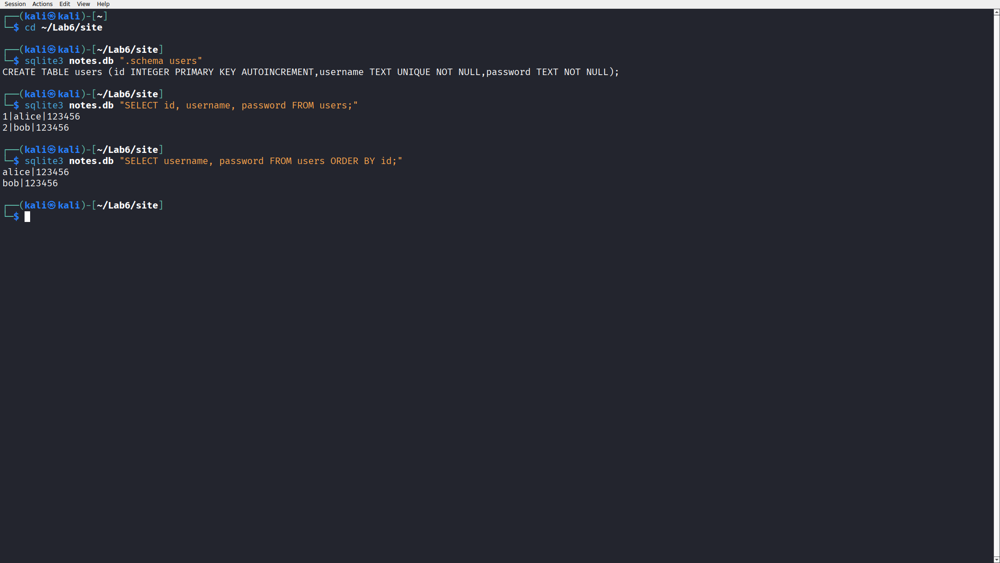
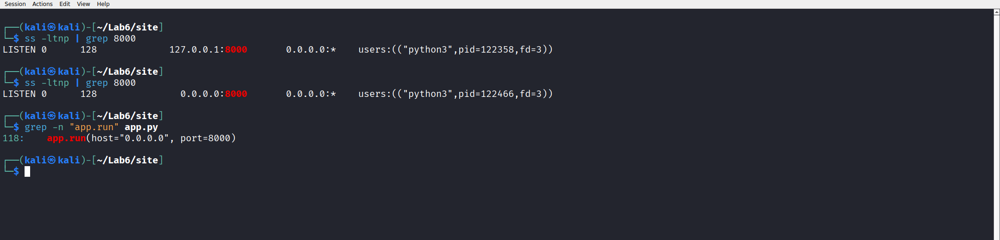
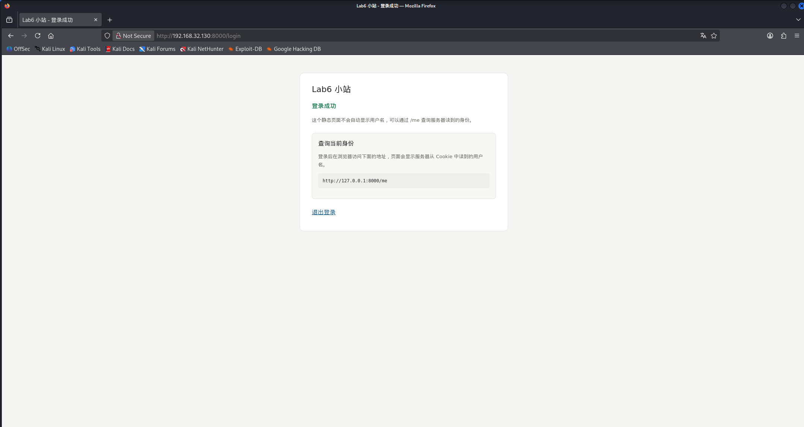
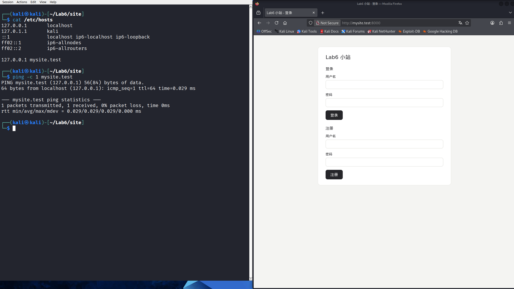

# Lab6：Flask 注册登录站与 HTTP 观察

本实验从零搭建一个带注册、登录功能的小网站，实验内容按以下顺序安排：

1. 确认网络环境，记录 IP 地址；
2. 安装缺少的软件（Flask、sqlite3），并说明各自用途；
3. 前端：用 HTML 编写页面结构，由页面缺少样式引出 CSS，由页面缺少交互引出 JavaScript；
4. 前端无法处理表单数据，引出后端；后端与浏览器之间的通信协议是 HTTP；
5. 注册数据需要持久化保存，引出数据库，介绍基本 SQL 语句；
6. 登录状态的维持依赖 Cookie；
7. 站点仅在局域网内可达、公网不可达的原因，属于计算机网络的内容。

本实验使用 Lab3 的 Kali 虚拟机、SSH 和 VSCode Remote-SSH，并复用 Lab5 的 HTTP 与 Cookie 知识。所有对请求和响应的观察均使用浏览器自带的开发者工具完成，无需额外安装工具。每个新概念在首次出现的位置给出解释。

站点包含两处教学缺陷：密码明文保存，服务器直接信任 Cookie 中的用户名。站点只能在本机和课程虚拟机内网运行，禁止部署到公网或用于真实账号。

---

## 一、交什么、按什么顺序做

提交 1 份填写完整的 `Lab6.md`、5 个源码文件和 4 张截图，共 10 个文件。报告中的命令输出、状态码和截图应来自同一次实验环境。

| 步骤       | 完成内容                                    | 位置    |
| :------- | :-------------------------------------- | :---- |
| 确认网络环境   | 查看并记录 Kali 的 IP 地址，测试连通                 | 第二节   |
| 环境搭建     | 安装 Flask、sqlite3，准备源码文件                 | 第三节   |
| 前端       | HTML、CSS、JS，补注册表单和一段 JS                 | 第四节   |
| 后端与 HTTP | 补 /login、/register 的路由声明和字段读取，启动后端，看 /login 怎么到达后端，用开发者工具观察请求与响应 | 第五节   |
| 数据库与 SQL | 用 sqlite3 查看 users 表，验证数据持久化            | 第六节   |
| Cookie   | 补成功页面板和 /me 接口，验证登录状态，伪造身份              | 第七节   |
| 计算机网络    | 修改监听地址，从 Windows 访问，解释局域网与公网            | 第八节   |
| 记录与提交    | 填写记录表和问答，回传源码，整理 10 个文件                 | 第九、十节 |

源码文件如下：

```text
site/
├── app.py
├── pages/
│   ├── login.html
│   ├── home.html
│   └── retry.html
└── static/
    └── style.css
```

| 文件                 | 作用               | 学生操作                      |
| :----------------- | :--------------- | :------------------------ |
| `pages/login.html` | 登录、注册表单          | 补 TODO 1（注册表单）、TODO 2（JS） |
| `pages/home.html`  | 登录成功页            | 补 TODO 6（身份查询面板）          |
| `pages/retry.html` | 失败页及状态码说明        | 阅读                        |
| `static/style.css` | 共用样式             | 使用已有类，不改文件                |
| `app.py`           | 后端：路由、数据库、Cookie | 补 TODO 3、4（/login 的路由声明与字段读取）、TODO 5（/register 的路由声明）、TODO 7（/me 接口），修改监听地址 |

七个 TODO 均附有可直接使用的代码或参考答案。填写前先阅读旁边的解释说明；完成后按手册中的步骤验证。

---

## 二、确认网络环境并记录 IP 地址

### 2.1 什么是 IP 地址

网络中每台设备都需要一个编号，别的设备才能找到它，这个编号就是 IP 地址。

现在广泛使用的 IPv4 地址由 32 位二进制数组成，书写时分成 4 段、每段 8 位，各自换成 0～255 的十进制数，用点隔开，例如 `192.168.88.128`。一台机器可以同时有多个 IP 地址，分别属于它的每块网卡，下一小节会看到 Kali 同时有 `127.0.0.1` 和 `192.168.x.x` 两个地址。

### 2.2 查看本机地址

在 Kali 终端执行：

```bash
ip addr
```

`ip addr` 列出系统里每块网卡的信息。网卡是机器连接网络的接口。典型的输出（数字会不同）：

```text
1: lo: <LOOPBACK,UP,LOWER_UP> mtu 65536 state UNKNOWN
    inet 127.0.0.1/8 scope host lo
2: eth0: <BROADCAST,MULTICAST,UP,LOWER_UP> mtu 1500 state UP
    link/ether 00:0c:29:xx:xx:xx
    inet 192.168.88.128/24 brd 192.168.88.255 scope global dynamic eth0
```

只需要看带 `inet` 的行，那是网卡的 IPv4 地址：

- `lo`：虚拟的回环网卡，地址 `127.0.0.1`。以 127 开头的地址都留给本机自己，发给它们的数据不会走到网卡外面，所以断网时本机内部照样能通信。后文用 `127.0.0.1` 指代"这台机器自己"。
- `eth0`：VMware 分配的虚拟网卡，地址形如 `192.168.x.x`。Lab3 配置 SSH 时用的就是它，Windows 通过这个地址连进 Kali。它为什么长这样、为什么叫"私有地址"，第八节解释。

地址后面的 `/8`、`/24` 是网段长度的写法，第八节讲。`link/ether` 那行是网卡的物理地址（MAC 地址），本实验用不到。

只想列出 IP 地址时，用更简短的命令：

```bash
hostname -I
```

把输出中的 `192.168.x.x` 记下来：第九节记录表要填，第八节从 Windows 访问要用。

### 2.3 测试连通

```bash
ping -c 2 223.5.5.5
ping -c 1 127.0.0.1
```

`ping` 向目标发送 ICMP 回显请求，对方每收到一个就回一个应答，用来测试"能不能到达"。`-c` 指定发几个包，不发这个参数它会一直发，需要 `Ctrl + C` 手动停。`223.5.5.5` 是阿里提供的公共 DNS 服务器地址，选它是因为稳定。正常输出：

```text
PING 223.5.5.5 (223.5.5.5) 56(84) bytes of data.
64 bytes from 223.5.5.5: icmp_seq=1 ttl=128 time=8.32 ms
64 bytes from 223.5.5.5: icmp_seq=2 ttl=128 time=7.91 ms

--- 223.5.5.5 ping statistics ---
2 packets transmitted, 2 received, 0% packet loss
```

两条命令都收到应答说明网络正常。第一条失败时先处理网络（见常见问题表）：第三节安装软件需要联网。

---

## 三、环境搭建：安装软件与准备文件

### 3.1 要装什么、各自是干什么的

Kali 基于 Debian Linux。Debian 系用 `apt` 管理软件：全世界的软件被打包成一个个"软件包"放在官方仓库里，`apt` 负责从仓库下载、安装、管理它们。安装系统级软件需要管理员权限，`sudo` 表示"以管理员身份执行下面这条命令"，因此会先要求输入一次密码。

本实验要装两个 Kali 默认没有的软件包：

| 软件包             | 是什么                                                                                  | 本实验用来做什么        |
| :-------------- | :----------------------------------------------------------------------------------- | :-------------- |
| `python3-flask` | Flask，Python 的 Web 框架。编写网站后端存在大量通用工作：解析 HTTP 报文、把路径分给处理函数、构造响应。框架已完成这些工作，开发者只需编写业务逻辑 | 运行本站后端 `app.py` |
| `sqlite3`       | SQLite 数据库的命令行工具。SQLite 是最简单的一种数据库：整个数据库就是一个文件，用 SQL 语言读写，不需要单独安装数据库服务程序             | 第六节查看数据库里的用户记录  |

### 3.2 安装并验证

逐条执行：

```bash
sudo apt update
sudo apt install -y python3-flask sqlite3
python3 -c "import flask; print(flask.__version__)"
```

三条命令分别是：

- `apt update`：刷新可用软件包的列表（只更新列表，还没装东西）；
- `apt install -y ...`：安装两个软件包，`-y` 表示安装过程中的确认全部自动选"是"；
- 最后一条验证：`python3 -c "..."` 表示用 Python 执行引号里的代码，`import flask` 把 Flask 库加载进来，`print(flask.__version__)` 打印版本号。

最后一条的输出形如 `3.1.0` 或 `2.3.3`，打印出版本号就说明装好了，2.x、3.x 均可。

### 3.3 apt 安装失败时的备选：虚拟环境

个别环境下 apt 装不上，改用 Python 自带的虚拟环境：

```bash
sudo apt install -y python3-venv
python3 -m venv ~/lab6venv
~/lab6venv/bin/pip install flask -i https://pypi.tuna.tsinghua.edu.cn/simple
```

虚拟环境是单独一套 Python 库目录：在它里面装的库只对它自己可见，不影响系统 Python，也不需要管理员权限。`pip` 是 Python 自己的包安装工具（和 apt 是两套体系，装的东西不同），`-i` 指定清华镜像源加快下载。使用虚拟环境时，后文所有 `python3 app.py` 都替换为 `~/lab6venv/bin/python app.py`。

### 3.4 建立作业目录并复制到 Kali

在 Windows 的 Git Bash 中进入课程仓库根目录，将 `学号姓名` 替换为本人目录名，逐条执行：

```bash
mkdir -p 学号姓名/Lab6/imgs
cp homework/Lab6/kimi/Lab6.md 学号姓名/Lab6/
cp -r homework/Lab6/kimi/site 学号姓名/Lab6/
```

- `mkdir -p` 一次建出多级目录：`学号姓名/Lab6/imgs` 三层一起建好，`imgs/` 以后放截图；
- 两条 `cp` 分别复制报告模板和源码目录，`-r` 表示连目录带内容递归复制。

报告和截图保存在 Windows 仓库；源码在 Kali 中修改和运行，完成后按 10.1 节回传。

接着把整个 `Lab6` 目录复制到 Kali 的用户主目录（`~` 是主目录的简写）。用 VMware Tools 直接拖过去即可；也可以用命令：

```bash
scp -r 学号姓名/Lab6 kali@虚拟机IP:~/
```

`scp` 是通过 SSH 通道复制文件的命令，用法和 `cp` 类似，区别是源或目标可以写成 `用户名@主机:路径`——Lab3 用 SSH 登录 Kali 时输入的就是同样的 `kali@虚拟机IP`。`虚拟机IP` 用第二节记下的地址。第一次连接会问是否信任该主机，回答 yes 后输入 Kali 的密码。

复制完成后，用 Lab3 配好的 VSCode Remote-SSH 打开 Kali 中的 `~/Lab6/site/`，后面修改 HTML 和 Python 都在这个远程目录里完成，保存即生效，不需要来回传文件。

---

## 四、前端：HTML、CSS 与 JavaScript

网页前端由三种语言组成，分工固定：HTML 描述结构（页面包含哪些内容），CSS 描述样式（页面外观），JavaScript 描述行为（交互逻辑）。本节依次介绍三种语言，并完成两个练习。

### 4.1 HTML：页面有什么

HTML 是描述网页结构的标记语言。它用一对对尖括号标签标出"这里是什么"：`<h1>` 是一级标题，`<p>` 是一段文字，`<input>` 是输入框。标签通常成对出现，`<body>...</body>` 表示这对标签之间的内容是网页主体。标签可以带属性，写成 `名字="值"`，放在开始标签里。标签可以嵌套，但必须正确闭合：先开的标签后关。

打开 `pages/login.html`，整个文件分三块看。

第一块，文件开头到 `</head>`，是页面的"说明书"：

```html
<!DOCTYPE html>
<html lang="zh-CN">
<head>
<meta charset="utf-8">
<title>Lab6 小站 - 登录</title>
<link rel="stylesheet" href="/static/style.css">
</head>
```

- `<!DOCTYPE html>`：声明这是一个 HTML5 文档，固定写法；
- `<html lang="zh-CN">`：整个页面从这里开始，`lang` 告诉浏览器内容是中文；
- `<meta charset="utf-8">`：字符编码用 UTF-8，没有这行中文可能乱码；
- `<title>`：显示在浏览器标签页上的标题；
- `<link rel="stylesheet" href="/static/style.css">`：声明本页使用一个样式表，`href` 是它的地址。这行先记住，4.2 讲它。

第二块，`<body>` 开始，是页面内容：

```html
<body>
<main class="card">
  <h1>Lab6 小站</h1>
  <h2>登录</h2>
```

- `<main class="card">`：主要内容区块。`class` 属性引用一个 CSS 类，这里引用了 `card`，4.2 讲类是干什么的；
- `<h1>`、`<h2>`：一级、二级标题，浏览器默认把标题渲染得更大更粗。

第三块是本页的核心，登录表单：

```html
  <form method="post" action="/login">
    <label>用户名
      <input type="text" name="username" autocomplete="off">
    </label>
    <label>密码
      <input type="password" name="password">
    </label>
    <button type="submit">登录</button>
  </form>
```

- `<form>`：表单，负责收集用户输入并提交给后端。它最重要的两个属性是 `method="post"` 和 `action="/login"`；
- `<label>`：把文字和输入框绑定成一组，点击文字也能选中输入框；
- `<input>`：输入框，是"自闭合"标签，没有结束标签。`type="text"` 是普通文本框；`type="password"` 把输入显示为圆点——这只是浏览器显示层面的处理，传输的内容仍是明文。`name="username"` 给这个输入框的数据起字段名。`autocomplete="off"` 让浏览器不要自动填充历史输入；
- `<button type="submit">`：提交按钮，点击后提交它所在的表单。

用户点"登录"后，浏览器把表单变成一个 HTTP 请求发出去，规则由三个属性决定：

| 属性                | 作用                                  |
| :---------------- | :---------------------------------- |
| `method="post"`   | 请求方法用 POST，字段放进请求体；GET 方法则把字段拼进 URL |
| `action="/login"` | 请求发往 `/login` 这个路径                  |
| `name="username"` | 指定字段名，后端按名字取值                       |

两种方法提交的字段格式相同，都是 `username=alice&password=123456`，Lab5 的请求方式题见过这种编码。区别在放哪里：GET 放 URL，会进浏览器历史和服务器访问日志，所以登录密码这种数据用 POST 放请求体。`/login` 这个路径怎么找到后端、这段请求长什么样，5.5 和 5.7 展开。

### 4.2 只有 HTML 不好看：CSS

在 Windows 资源管理器里双击 `学号姓名/Lab6/site/pages/login.html`，浏览器直接打开这个本地文件。观察两点：

1. 内容都在：标题、两个输入框、登录按钮都显示出来了；
2. 缺少样式：黑字白底，输入框没有圆角和边框装饰，整个页面也没有灰色卡片背景。

页面缺少样式的原因：HTML 只负责结构，外观由 CSS 负责。本页引用的样式表地址是 `/static/style.css`。本地双击打开时，浏览器向该路径请求样式表，本机没有任何程序提供该文件，请求失败，页面因此没有样式。第五节启动后端后再访问，样式即会生效：`style.css` 由后端提供。

CSS 是描述样式的语言。规则写成"选择器 { 属性: 值 }"，`static/style.css` 里的一条：

```css
.panel {
  padding: 16px;
  background: #f7f7f4;
  border: 1px solid #e2e2dd;
}
```

逐项拆开：

- `.panel` 是选择器，意思是"匹配所有 `class="panel"` 的元素"。选择器以 `.` 开头表示按类匹配；写在 CSS 里的选择器语法，和 JS 里找元素用的语法是同一套，4.3 会用到；
- 花括号里是若干条声明：`padding: 16px` 内边距 16 像素，`background: #f7f7f4` 背景用十六进制颜色值，`border: 1px solid #e2e2dd` 一像素浅灰实线边框。

样式定义一次，所有引用该类的元素自动生效：HTML 侧只需写 `class="panel"`，不含任何样式代码。这就是"结构和样式分离"：改样式只改 CSS 文件，改内容只改 HTML。本实验已提供四个类，需要时直接引用：

| 类         | 样式用途                    |
| :-------- | :---------------------- |
| `card`    | 页面主容器：白底、圆角、水平居中、最大宽度限制 |
| `panel`   | 带背景、边框和内边距的内容区域         |
| `tip`     | 小号灰色说明文字                |
| `success` | 绿色加粗的成功提示文字             |

对照 4.1 的 `<link rel="stylesheet" href="/static/style.css">`：`rel="stylesheet"` 说明链接的是一个样式表，`href` 是它的地址。浏览器渲染页面时，会按这个地址把 CSS 下载下来再套用到页面上。

### 4.3 页面不会动：JavaScript

该页面缺少交互行为：按钮没有事件处理，输入也不做检查。这类工作由第三种语言完成：JavaScript（简称 JS），运行在浏览器里的编程语言。

先通过一个实验观察 JS 的作用。在浏览器里按 `F12` 打开开发者工具，切换到"控制台"（Console）标签页。控制台是一个可以输入并执行 JS 代码的对话框。输入下面这行，回车：

```js
document.querySelector("h1").textContent = "我被 JS 改了";
```

页面上的大标题随之变为"我被 JS 改了"。这行代码的各部分含义：

- `document`：浏览器提供给 JS 的对象，代表整个页面；
- `.querySelector("h1")`：在页面里按选择器找一个元素。`"h1"` 匹配第一个 `<h1>` 标签——这和 4.2 CSS 选择器是同一套语法，按类找就写 `".panel"`，按属性找就写 `"[name='username']"`；
- `.textContent = "..."`：把这个元素里的文字改成等号右边的内容。

在控制台再输入一行：

```js
alert("我是弹窗");
```

`alert()` 弹出一个提示框。查找元素、对元素执行操作，是前端交互的两项基本能力。真实网站里，JS 代码写在 HTML 的 `<script>` 标签内，页面加载时自动执行；常见用途是监听事件：某个按钮被点击、某个表单被提交时，自动执行一段函数。4.5 的练习即为此类事件监听。

实验完成后关闭开发者工具。

### 4.4 做题一（TODO 1）：注册表单

打开 `pages/login.html`，把整个 TODO 1 注释块替换为：

```html
<h2>注册</h2>
<form method="post" action="/register">
  <label>用户名
    <input type="text" name="username" autocomplete="off">
  </label>
  <label>密码
    <input type="password" name="password">
  </label>
  <button type="submit">注册</button>
</form>
```

结构和上面的登录表单完全一样，只改了三处：标题文字、`action` 换成 `/register`、按钮文字。对照 4.1 的三条规则自查：提交到 `/register`，方法 POST，两个输入框的字段名是 `username` 和 `password`。保存。

### 4.5 做题二（TODO 2）：给注册表单挂一个事件

`login.html` 的末尾已经放好了一个空的 `<script>` 标签（在 `</body>` 之前）。把里面的 TODO 2 注释替换为：

```js
  var form = document.querySelector("form[action='/register']");
  form.addEventListener("submit", function () {
    var username = form.querySelector("[name='username']").value;
    var password = form.querySelector("[name='password']").value;
    alert("将发送到后端：username=" + username + "&password=" + password);
  });
```

逐行解释：

- `var form = document.querySelector("form[action='/register']")`：找到注册表单。选择器 `form[action='/register']` 匹配"action 属性等于 /register 的 form 标签"——属性选择器，还是 CSS 那套语法。`var` 声明一个变量保存结果，后面要用；
- `form.addEventListener("submit", function () {...})`：给表单挂一个事件监听。`"submit"` 是事件名，表单被提交时触发；第二个参数是触发时执行的函数，此处直接书写匿名函数；
- `form.querySelector("[name='username']")`：在表单内部找 `name` 为 `username` 的输入框；`.value` 读出输入框里的内容。`password` 同理。这两行把将要发给后端的数据读了出来；
- `alert(...)`：弹出提示框，内容用 `+` 把文字和变量拼接起来。


弹出内容正是 `username=alice&password=123456` 的形式。5.10 节在 F12 网络面板里看到的请求体就是这个格式，此处先看到它长什么样。

保存后验证：回到浏览器刷新本地打开的 `login.html`，填写用户名密码，点击"注册"。提示框应先弹出，内容为刚填写的用户名和密码；点击确定后浏览器才发出请求（此时页面提示无法访问，原因见第五节，启动后端后即可正常提交）。事件处理函数在请求发出之前执行，说明 JS 代码已在浏览器中运行。

若提示框未弹出，按 `F12` 打开开发者工具的"控制台"标签，红色的行即 JS 报错；最常见原因是 TODO 1 尚未完成（`querySelector` 找不到注册表单，控制台报 `form is null`）、替换后缺少行、选择器引号不配对。修正后保存并刷新页面。

### 4.6 前端做不到的事

到这一步，前端已包含结构、样式和交互三个部分。下列工作仍无法由前端完成：

- **处理数据**：表单提交到 `/register` 后，接收请求、检查用户名是否重复的逻辑，需要由服务器上的程序实现。浏览器只负责发送请求；
- **保存数据**：注册的用户需要长期保存，浏览器关闭或更换设备后数据仍应可用；
- **服务多个用户**：其他用户注册时，需要一个持续运行的服务端接收其请求。

这些工作由后端程序完成：它在服务器上持续运行，接收请求、执行处理并返回响应。下一节先补写后端的路由声明和字段读取（TODO 3、4、5），再启动后端，观察前后端之间的通信内容。

---

## 五、后端与 HTTP：请求是怎么被处理的

### 5.1 后端是什么

后端是服务器上持续运行的程序，工作循环是：接收请求 → 按路径找到对应的处理函数 → 执行业务逻辑（查数据、做判断）→ 返回响应。

整个网站的结构：

```text
浏览器（前端）
  HTML 结构 / CSS 样式 / JS 行为，三者均运行在浏览器里
  │
  │  HTTP 请求：POST /login、GET /home 等
  │  HTTP 响应：状态码 + 页面
  ▼
后端 app.py（Flask）
  ① 接收请求  ② 查路由表  ③ 执行函数  ④ 返回响应
  │
  │  SQL：INSERT / SELECT
  ▼
数据库 notes.db（SQLite，磁盘上的一个文件）
```

分工说明：浏览器和后端之间只通过 HTTP 报文交流；后端和数据库之间用 SQL 语句交流；浏览器从头到尾没有直接碰过数据库。

### 5.2 app.py 总览

`app.py` 用 Flask 实现上图中间一层。文件不长，从上到下扫一遍结构：

```python
from flask import Flask, jsonify, make_response, request, send_from_directory
```

从 Flask 库导入要用的东西：`Flask` 是应用对象；`request` 代表收到的请求，读表单、读 Cookie 都从它来；`make_response` 构造响应；`jsonify` 把字典转成 JSON 响应（第七节用）；`send_from_directory` 从目录里返回文件（本站用它发 HTML）。

再往下是三个小工具函数：`db()` 连接数据库，`init_db()` 建表（第六节细讲），`page(name)` 把 `pages/` 目录下的 HTML 文件作为响应返回。

核心是路由：路径与处理函数的对应关系。每个函数上方的 `@app.route(...)` 是一条路由声明。`@` 开头的写法叫装饰器，作用是在函数外挂一层额外行为，这里的行为是"把下面的函数注册到路由表"。本站的全部路由：

| 路径 | 方法 | 处理函数做什么 | 成功返回 |
| :--- | :--- | :--- | :--- |
| `/` | GET | 返回登录页 | 200 |
| `/login` | POST | 查数据库验证，成功后设置 Cookie | 200 |
| `/register` | POST | 往数据库插入一条用户记录 | 201 |
| `/home` | GET | 读 Cookie，有值返回成功页，没值返回登录页 | 200 |
| `/me` | GET | 把 Cookie 里的用户名用 JSON 返回（第七节实现） | 200 |
| `/logout` | GET | 删除 Cookie，返回登录页 | 200 |

`@app.route("/login", methods=["POST"])` 里的 `methods` 限定这个路径只收 POST 方法，收到 GET 就返回 405，5.12 会验证。`/login` 和 `/register` 的路由声明当前留作 TODO 3 和 TODO 5，5.3、5.4 补齐后再启动站点。

### 5.3 做题三（TODO 3、TODO 4）：/login 的路由声明与字段读取

打开 `app.py`，`/` 和 `/home` 的路由声明已经写好，`login()` 上方是空的。路由声明的写法在 `index()` 上方就能看到一个例子：

```python
@app.route("/")
```

`@app.route(路径)` 把下面的函数注册进路由表：请求路径与括号里的路径一致时，Flask 调用这个函数。括号内再加 `methods=["POST"]`，表示该路径只接受 POST 方法。

找到 `login()`，把 TODO 3 注释替换为这一行，顶格书写、与 `def` 对齐：

```python
@app.route("/login", methods=["POST"])
```

第二个空是字段的读取。`login()` 里已经写好了第一行：

```python
    username = request.form.get("username", "").strip()
```

`request.form` 是请求体里的表单数据（5.7 节会看到它是浏览器把表单编码后的结果）；`get("username", "")` 按字段名取值，字段不存在时返回第二个参数指定的默认值；`.strip()` 去掉字符串两端的空白字符，防止误输入的空格被当成用户名的一部分。仿照这一行，把 TODO 4 注释替换为：

```python
    password = request.form.get("password", "")
```

密码不做 `.strip()`：有些密码允许以空格开头或结尾，去掉反而改变了密码。两行都保持四空格缩进。

### 5.4 做题四（TODO 5）：/register 的路由声明

写法与 TODO 3 相同。找到 `register()`，把 TODO 5 注释替换为：

```python
@app.route("/register", methods=["POST"])
```

`register()` 内部的字段读取两行已经写好，写法与 TODO 4 一致，不再重复。补完后本节的三个 TODO 都已替换，可以启动了。

### 5.5 启动

在 Kali 终端执行：

```bash
cd ~/Lab6/site
python3 app.py
```

预期输出：

```text
 * Serving Flask app 'app'
 * Running on http://127.0.0.1:8000
```

解释这个地址。IP 地址定位机器，端口号定位机器上的程序。一台机器同时运行多个服务，靠端口号区分：SSH 监听 22 端口（Lab3 连它用的），我们的 Flask 监听 8000 端口。`http://127.0.0.1:8000` 的含义是连接 `127.0.0.1` 这台机器上的 8000 端口。冒号前是 IP，冒号后是端口，这个格式后面反复出现。

**保持该终端运行**：后端进程退出后站点即不可访问。再开一个终端执行后面的命令。要停止时在 Flask 终端按 `Ctrl + C`。

### 5.6 浏览器完成注册

在 Kali 浏览器打开 `http://127.0.0.1:8000`。与 4.2 本地打开相比，样式此时生效：灰色背景、白色圆角卡片、带边框的输入框。`style.css` 由后端在 `/static/` 路径下提供，浏览器请求到它，样式即应用到页面。页面下方还有 4.4 补的注册表单。

用测试数据注册两个账号。密码仅用于本地实验，不要换成真实密码。

| 用户名 | 密码 |
| :--- | :--- |
| `alice` | `123456` |
| `bob` | `123456` |

操作流程：填写用户名和密码，点击"注册"，提示框弹出（4.5 的 JS），点击确定后出现"登录成功"页；点击页面下方的"退出登录"返回登录页，再注册 `bob`。

成功页上有一行灰色小字："这个静态页面不会自动显示用户名，可以通过 /me 查询服务器读到的身份"。该接口在第七节实现。

当前留有一个问题：Flask 进程重启后，`alice` 是否仍能登录？数据存放于何处？第六节解答。

### 5.7 /login 是怎么到后端的

这是本实验最重要的一段。以登录为例，从点击"登录"按钮到后端的 `login()` 函数开始执行，中间发生了什么，一步一步走一遍。

**浏览器侧，五步：**

第 1 步，确定目标地址。表单的 `action="/login"` 是一个相对路径：只有路径，没有主机。浏览器把它拼到当前页面地址的主机部分上。当前页面是 `http://127.0.0.1:8000/`，主机部分是 `127.0.0.1:8000`，拼出完整目标：

```text
http://127.0.0.1:8000/login
```

`http://` 是协议，`127.0.0.1` 是 IP，`8000` 是端口，`/login` 是路径。

第 2 步，确定请求方法。`method="post"`，用 POST，字段放请求体。

第 3 步，收集表单数据。浏览器扫描表单内所有带 `name` 的输入框，把当前值按 `name=value&name=value` 编码成请求体：

```text
username=alice&password=123456
```

第 4 步，建立连接。浏览器向 `127.0.0.1` 这台机器的 `8000` 端口发起 TCP 连接。注意：这一步只用到 IP 和端口，`/login` 不参与找机器，它是连接建立之后发给对方的内容。

第 5 步，发送请求文本，等待响应。发出去的请求长这样（5.9 拆它的结构）：

```http
POST /login HTTP/1.1
Host: 127.0.0.1:8000
Content-Type: application/x-www-form-urlencoded

username=alice&password=123456
```

`Content-Type: application/x-www-form-urlencoded` 是表单默认的编码类型，告诉后端"请求体是表单编码的键值对"。

**服务器侧，三步：**

第 6 步，接收。Flask 进程一直监听着 8000 端口（`app.run(port=8000)` 干的就是这件事），操作系统的网络栈把这条连接上收到的数据交给它。

第 7 步，查路由表。Flask 解析请求文本的第一行，取出方法 `POST` 和路径 `/login`，去路由表里匹配：`@app.route("/login", methods=["POST"])` 命中，处理函数是 `login()`。

第 8 步，执行。Flask 调用 `login()`，把请求的各项数据装进 `request` 对象。函数里的 `request.form.get("username", "")` 就是从请求体里按字段名取值，取到 `alice`。

**两级寻址的分工：**

> IP + 端口负责把数据送达目标机器上的目标程序；路径负责向该程序说明所请求的资源。

浏览器地址栏里的每个网址都经过这两级寻址。第八节把 `127.0.0.1` 换成域名（hosts）、换成 Kali 私有 IP（跨机器访问），均遵循上述分工。

### 5.8 一次注册的完整过程

把 5.7 的机制套到注册 `bob` 上，共五步：

1. 浏览器把表单编码为请求体 `username=bob&password=123456`，POST 到 `/register`（过程同 5.7，只是路径和字段值不同）；
2. Flask 查路由表，`@app.route("/register", methods=["POST"])` 命中，调用 `register()`；
3. `register()` 执行 `INSERT INTO users ...`，SQLite 在 users 表写入一行（第六节细看）；
4. `register()` 构造响应：状态码 201，响应体 home.html，响应头加 `Set-Cookie: user=bob`；
5. 浏览器显示成功页，保存 Cookie。

第 1、4、5 步走 HTTP（浏览器和 Flask 之间），第 3 步走 SQL（Flask 和 SQLite 之间）。

### 5.9 HTTP 报文的结构

HTTP 是浏览器和服务器之间的通信协议。请求和响应都是纯文本，结构固定：

请求（浏览器发给服务器）：

```text
请求行：方法 路径 协议版本        例如 POST /login HTTP/1.1
请求头：若干"名字: 值"的行       例如 Host、Content-Type、Cookie
空行：请求头的结束标记
请求体：POST 提交的数据；GET 通常没有
```

响应（服务器发给浏览器）：

```text
状态行：协议版本 状态码 短语      例如 HTTP/1.1 200 OK
响应头：若干"名字: 值"的行       例如 Content-Type、Set-Cookie
空行
响应体：HTML、JSON 等内容
```

请求头里每行是一个"名字: 值"，类似信封上的信息；请求体是正文。对照 5.7 第 5 步发出去的请求：第一行是请求行，中间三行是请求头，空行之后是请求体，结构完全吻合。接下来用开发者工具把浏览器收发的这些文本原样看一遍。

### 5.10 用开发者工具看请求与响应

浏览器自带的开发者工具能把每次请求和响应的原文展示出来。

操作（Kali 的 Firefox，其他浏览器类似）：

1. 在 Kali 浏览器按 `F12`，切换到"网络"（Network）标签页；
2. 点左上角的垃圾桶图标清空旧记录；
3. 在登录表单填 `alice` / `123456`，点"登录"。注意这次没有提示框弹出：4.5 的 JS 只挂在注册表单上；
4. 列表里出现一行 `login`，即刚才那次请求。点击它；
5. 右侧面板逐栏查看：
   - 头部信息（Headers）：请求方法 `POST`、状态码 `200`、远程地址 `127.0.0.1:8000`；上半部分列出全部请求头，下半部分列出全部响应头；
   - 响应头里找到 `Set-Cookie: user=alice; Path=/`；
   - 请求（Request）标签：请求体 `username=alice&password=123456`；
   - 响应（Response）标签：返回的 HTML，内容即 `pages/home.html`。

对照 5.7 的结构逐项核对。再点一次"退出登录"，列表里多出一行 `logout`，它的请求方法是 GET——GET 请求没有请求体，请求标签里为空。

### 5.11 状态码

状态码是状态行里的三位数字，表示处理结果。第一位是大类：

| 大类 | 含义 |
| :--- | :--- |
| 2xx | 成功 |
| 3xx | 重定向，Lab5 的 302 属于这类 |
| 4xx | 客户端错误：请求本身有问题 |
| 5xx | 服务器错误：服务器自己出错了 |

本实验会遇到 7 个，`retry.html` 页面上印着其中 3 个：

| 状态码 | 含义 | 本站对应场景 |
| :--- | :--- | :--- |
| 200 | 成功 | 返回页面 |
| 201 | 已创建 | 注册成功，插入了一条新记录 |
| 400 | 请求有误 | 用户名或密码为空 |
| 401 | 未通过验证 | 密码错误 |
| 404 | 未找到 | 访问不存在的路径，Flask 自带页面 |
| 405 | 方法不被允许 | 用 GET 访问只收 POST 的 `/login` |
| 409 | 冲突 | 注册时用户名已存在 |

### 5.12 验证失败请求

四个错误状态码都能在浏览器里造出来，每个都在 F12 网络面板里看状态码确认：

| 操作 | 预期 |
| :--- | :--- |
| 登录表单填 `alice` / `wrong`，点登录 | 失败页，`login` 行状态码 401 |
| 注册表单再注册一次 `alice` | 失败页，`register` 行状态码 409 |
| 地址栏直接输入 `http://127.0.0.1:8000/login` 回车 | 405 页面（Flask 自带的英文错误页）：地址栏回车发的是 GET，而 `/login` 只收 POST |
| 地址栏输入 `http://127.0.0.1:8000/abc` 回车 | 404 页面：没有这个路径的路由 |
| 登录表单两个框都留空，点登录 | 失败页，状态码 400：空字段检查在后端做 |

关于最后一项：字段非空检查也可以用 4.5 的 JS 实现，但 JS 运行在用户的浏览器中，用户可以禁用或修改它；后端的检查对所有客户端生效。安全上的原则：服务器收到的一切数据，都必须在服务器端再次验证。

---

## 六、数据库与 SQL：数据存在哪

### 6.1 为什么要数据库

回答 5.6 留的问题。程序里的变量放在内存里，进程一结束就没了——Flask 一关，注册的用户就消失，这显然不行。把用户写进一个文本文件可以持久化，但每次读写都要自己处理格式；查"有没有叫 alice 的用户"要自己写循环逐行比对；两个请求同时写一个文件还会互相覆盖。

数据库把这些问题统一解决：按表结构存放数据，提供现成的查询语言（SQL），自带并发控制，重启后数据仍在。本站用 SQLite：整个数据库就是一个文件（本站的 `notes.db`），不需要单独安装数据库服务程序，适合小型站点。MySQL、PostgreSQL 这类数据库要单独装服务、开端口，功能更强，对本实验来说多余。

### 6.2 表、行、列

数据库里的数据存在表里。一张表有固定的列，每行是一条记录，结构类似带表头的表格：`users` 表有三列，注册一个用户就是增加一行。

首次启动时，`app.py` 的 `init_db()` 建表，SQL 语句是：

```sql
CREATE TABLE IF NOT EXISTS users (
  id INTEGER PRIMARY KEY AUTOINCREMENT,
  username TEXT UNIQUE NOT NULL,
  password TEXT NOT NULL
);
```

SQL（Structured Query Language）是操作数据库的标准语言，上面是一条建表语句：建一张叫 `users` 的表，`IF NOT EXISTS` 表示已存在就跳过（所以重启不会报错也不会清空数据）。三列的类型和约束：

| 列 | 类型 | 约束 | 含义 |
| :--- | :--- | :--- | :--- |
| `id` | INTEGER | `PRIMARY KEY AUTOINCREMENT` | 主键：每行的唯一编号，新行自动加一 |
| `username` | TEXT | `UNIQUE NOT NULL` | 不允许重复、不允许为空；重复注册在这里报错，后端转成 409 |
| `password` | TEXT | `NOT NULL` | 不允许为空；本实验按明文保存 |

### 6.3 后端用到的两条 SQL

后端访问数据库只用两条语句。注册时（`register()` 里）：

```sql
INSERT INTO users (username, password) VALUES (?, ?);
```

`INSERT INTO 表名 (列名...) VALUES (值...)` 插入一行。登录时（`login()` 里）：

```sql
SELECT id FROM users WHERE username = ? AND password = ?;
```

`SELECT 列名 FROM 表名 WHERE 条件` 查找满足条件的行，查不到就是空结果。`login()` 拿到空结果就返回 401，查到就发 Cookie。

两条语句里的 `?` 是参数占位符，实际的值由 sqlite3 驱动单独传给数据库，对应 `app.py` 里这两行：

```python
conn.execute("INSERT INTO users (username, password) VALUES (?, ?)",
             (username, password))
```

这种参数化写法让用户输入永远不会被拼进 SQL 文本，是防 SQL 注入的基本手段：有人把恶意 SQL 语法填进注册框，也只会被当成普通的字符串值存进表里。

数据库文件的位置由 `app.py` 开头两行决定：

```python
BASE = os.path.dirname(os.path.abspath(__file__))
DB = os.path.join(BASE, "notes.db")
```

`__file__` 是 `app.py` 自己的路径，`os.path.dirname` 取它所在目录，最后拼出：`notes.db` 和 `app.py` 在同一目录，本实验中是 `~/Lab6/site/notes.db`。

### 6.4 用 sqlite3 工具查看

第三节装的 `sqlite3` 是 SQLite 的命令行工具，能直接打开数据库文件查看、执行 SQL。在另一个 Kali 终端执行：

```bash
cd ~/Lab6/site
sqlite3 notes.db ".schema users"
sqlite3 notes.db "SELECT id, username, password FROM users;"
```

用法：`sqlite3 数据库文件 "SQL语句"`，语句执行完自动退出。`.schema users` 是工具自带的命令（以 `.` 开头的是工具命令，非 SQL 语句），打印建表语句：

```text
CREATE TABLE users (
  id INTEGER PRIMARY KEY AUTOINCREMENT,
  username TEXT UNIQUE NOT NULL,
  password TEXT NOT NULL
);
```

第二条查询输出（5.6 注册的两个账号）：

```text
1|alice|123456
2|bob|123456
```

默认用竖线分隔各列，一行一条记录。`ORDER BY id` 可以按编号排序，执行以下命令验证：

```bash
sqlite3 notes.db "SELECT username, password FROM users ORDER BY id;"
```

保存 `imgs/lab6_db.png`：截取终端里两条命令和查询结果，要能看到 `alice` 和 `bob` 两行。



命令行之外也有图形工具，可选装一种辅助查看（截图仍以命令行输出为准）：

- **DB Browser for SQLite**：`sudo apt install -y sqlitebrowser`。安装后用它打开 `~/Lab6/site/notes.db`，切到"Browsing Data"标签页，`users` 表的内容以表格显示，和 6.4 查询结果一一对应。它能直接改动文件，本实验只用它查看，不要在里面改数据；
- **VSCode Remote-SSH + SQLite Viewer 扩展**：Lab3 配好的远程连接里，在扩展面板搜索并安装 SQLite Viewer，然后点击 `notes.db` 即以表格打开，不需要往系统里再装软件。

### 6.5 验证持久化

在 Flask 终端按 `Ctrl + C` 停止，再执行 `python3 app.py` 重启，然后重新登录 `alice`：仍然成功。用户保存在 `notes.db` 文件里，进程重启不影响文件，这就是"数据库负责持久化"的含义。再执行一遍 6.4 的查询，数据还在。

`notes.db` 是运行时生成的产物，提交时不要带（见 10.2）。

> **缺陷记录**：6.4 的查询结果里密码以明文显示。数据库文件一旦泄露，所有密码直接可读；用户在多个网站用同一个密码时，损失会扩大。实际系统在注册时计算密码的哈希值存入数据库，登录时验证哈希，数据库里看不到密码原文。

---

## 七、Cookie：登录状态与身份伪造

### 7.1 服务器无法记住登录状态

HTTP 的每个请求相互独立：服务器处理完一个请求后不保留其状态。5.6 中登录了 `alice`，紧接着请求 `/home`，服务器无法将这两个请求关联起来。要让服务器识别"已登录的用户"，每个请求都需要携带凭据。

### 7.2 Cookie 的机制

Cookie 是浏览器替网站保存的一小段数据，机制三步：

1. 登录成功时，服务器在响应头里下发：`Set-Cookie: user=alice; Path=/`；
2. 浏览器把 `user=alice` 存下来，`Path=/` 表示访问这个网站的任何路径都带上；
3. 之后浏览器发给这个网站的每个请求，都自动加一行请求头 `Cookie: user=alice`。

`app.py` 的 `login()` 里，`resp.set_cookie("user", username)` 干的就是第 1 步。完整过程六步：

1. 浏览器 POST `/login`，请求体是表单数据（5.7 的八步）；
2. `login()` 执行 `SELECT ... WHERE username = ? AND password = ?`，查到一行，验证通过；
3. 响应：状态码 200，响应体 home.html，响应头 `Set-Cookie: user=alice; Path=/`；
4. 浏览器显示成功页，把 `user=alice` 存进自己的 Cookie 存储；
5. 之后每个请求自动带 `Cookie: user=alice` 请求头（7.6 在网络面板里能看到）；
6. `/home` 收到请求，读 Cookie 有值 → 返回成功页。


服务器依据该值识别用户。上述三个环节均可在开发者工具中观察，见 7.6 节。

### 7.4 做题六（TODO 6）：成功页的查询面板

`/me` 是本站的身份查询接口（下一小节实现），成功页上为它预留了展示位置。打开 `pages/home.html`，把整个 TODO 6 注释块替换为：

```html
<section class="panel">
  <h2>查询当前身份</h2>
  <p class="tip">登录后在浏览器访问下面的地址，页面会显示服务器从 Cookie 中读到的用户名。</p>
  <pre>http://127.0.0.1:8000/me</pre>
</section>
```

用到的标签：`<section>` 表示一个内容区块；`<h2>` 小标题；`<p class="tip">` 一段说明文字，套用 4.2 表里的 `tip` 类；`<pre>` 按原文显示文本，空格和换行都保留，适合展示地址；外层 `class="panel"` 套用 `panel` 类，得到灰色圆角面板。

保存后，在 Kali 浏览器重新登录 `alice`，成功页应出现这个灰色面板。

### 7.5 做题七（TODO 7）：/me 接口

在 `app.py` 中找到 `me()`，把 TODO 注释和 `pass` 替换为下面两行，保留四空格缩进：

```python
    username = request.cookies.get("user", "")
    return jsonify({"user": username})
```

- `request.cookies.get("user", "")`：读取请求携带的名为 `user` 的 Cookie，没有时返回空字符串（第二个参数是默认值）；
- `jsonify({"user": username})`：把 Python 字典转成 JSON 响应。JSON 是一种用键值对表示数据的文本格式，`{"user": "alice"}` 表示键 `user` 的值是 `alice`，是接口返回数据的常用格式。`jsonify` 同时自动设置响应头 `Content-Type: application/json`，告诉客户端响应体是 JSON。

保存后重启 Flask：在 Flask 终端按 `Ctrl + C`，再执行 `python3 app.py`。

### 7.6 验证

三个观察，全部用 F12：

1. **看下发的 Cookie**：网络面板清空，重新登录 `alice`，点 `login` 那行，响应头里有 `Set-Cookie: user=alice; Path=/`（7.2 的第 3 步）；
2. **看浏览器存的 Cookie**：开发者工具切到"存储"（Storage）标签，左侧展开 Cookies，能看到一条记录：名称 `user`，值 `alice`（第 4 步）。该记录即浏览器保存的凭据；
3. **看自动携带的 Cookie 和 /me 的返回**：地址栏访问 `http://127.0.0.1:8000/me`，页面显示 `{"user":"alice"}`（`/me` 返回 JSON 文本，浏览器直接显示原文，属正常现象）。网络面板里点 `me` 那行，请求头里有 `Cookie: user=alice`——该请求头由浏览器自动添加（第 5 步）。

再验证默认值：点"退出登录"（`/logout` 会删除 Cookie），再访问 `/me`，显示 `{"user":""}`。

### 7.7 伪造身份

服务器只看 Cookie 的值，不检查它是怎么来的。Cookie 存在浏览器里，也就能在浏览器里改：

1. F12 → 存储 → Cookies → 找到 `user` 那行，双击"值"，改成 `nobody`，回车保存；
2. 访问 `http://127.0.0.1:8000/me`，显示 `{"user":"nobody"}`；
3. `nobody` 从未注册过。

原因就是 TODO 7 那两行：`/me` 直接返回客户端送来的值，没有验证它是否由登录过程签发。`/home` 也一样：Cookie 里只要有任意非空值，就返回成功页——把值改为任意非空字符串，访问 `/home` 验证。

这是本站的第二处教学缺陷。常见修复是服务端会话：登录后生成一个随机会话标识，服务器保存"标识 → 用户"的对应关系，Cookie 里只放标识；伪造的标识对不上任何会话，自然失效。Flask 自带的 `session` 配合妥善保管的 `SECRET_KEY` 可以对会话数据签名，实现同样效果。Lab5 从浏览器侧修改 Cookie、观察响应变化；本实验有了源码，可以直接在代码中定位信任边界所在的行。

---

## 八、IP 地址分类：为什么只有局域网访问得到

### 8.1 地址分类

第二节看到 Kali 有 `127.0.0.1` 和 `192.168.x.x` 两个地址，现在解释地址的类别。下表的 `10.0.0.0/8` 这种写法表示一个网段：斜杠后的数字是地址前多少位固定。`10.0.0.0/8` 表示以 10 开头的全部地址（10.0.0.0～10.255.255.255），`192.168.0.0/16` 表示以 192.168 开头的全部地址。第二节 `ip addr` 输出里 `192.168.88.128/24` 的 `/24` 就是这个意思：前三段固定，最后一段可变。

| 地址或范围 | 类别 | 本实验中的含义 |
| :--- | :--- | :--- |
| `127.0.0.0/8` | 回环地址段 | `127.0.0.1` 指当前机器自己，出不了网卡 |
| `10.0.0.0/8`、`172.16.0.0/12`、`192.168.0.0/16` | 私有地址段 | 保留给局域网内部使用（RFC 1918 文档规定）；Kali 的 `192.168.x.x` 来自这里 |
| 公网 IP | 全球唯一、可在互联网路由 | 学校或家里宽带的出口地址，本实验用不到 |

私有地址只在局域网内有意义，公网路由器不转发它。那 Kali 用私有地址怎么上网？靠 NAT（Network Address Translation，网络地址转换）：

```text
互联网
  │
  公网 IP（宽带的出口地址，全球唯一）
  │
Windows 宿主机
  VMware NAT 在这里做地址转换
  │
  192.168.88.0/24 局域网（私有地址段）
  │
Kali eth0：192.168.88.128
```

Lab3 的 VMware 网络用的就是 NAT 模式：Windows 宿主机在中间做翻译和转发，Kali 出网时把私有地址转换成宿主机的对外连接。所以 Windows 和 Kali 实际处在同一个 NAT 局域网里，互相用私有地址直连。

### 8.2 修改监听地址

Flask 启动时的这行决定监听哪个地址：

```python
app.run(host="127.0.0.1", port=8000)
```

先在另一个终端查看当前状态：

```bash
ss -ltnp | grep 8000
```

|  |  |
| --- | --- |
`ss` 列出系统的网络连接和监听状态：`-l` 只看监听，`-t` 只看 TCP，`-n` 用数字显示地址和端口，`-p` 显示占用端口的进程。`|` 把前一个命令的输出交给后一个命令，`grep 8000` 只保留含 8000 的行。典型输出：

```text
LISTEN 0 128 127.0.0.1:8000 0.0.0.0:* users:(("python3",pid=1234,fd=3))
```

第一列 `LISTEN` 表示监听状态，本地地址是 `127.0.0.1:8000`，最后的 `users:` 显示监听该端口的进程（python3）。当前只接受发往本机回环地址的连接，Windows 无法连入。

把 `app.py` 最后一行改为：

```python
app.run(host="0.0.0.0", port=8000)
```

|  |  |
| --- | --- |
重启 Flask，再执行 `ss -ltnp | grep 8000`，监听地址变为 `0.0.0.0:8000`。

`0.0.0.0` 在这里是一个服务端监听参数，意思是"接受发往本机任意 IPv4 网卡地址的 8000 端口连接"，这样从 Windows 过来的连接才能被接收。它只出现在 `app.run(host=...)` 里；浏览器地址栏里不要写它，访问时写 `127.0.0.1` 或 Kali 的实际 IP。

保存 `imgs/lab6_listen.png`：把修改前和修改后两次 `ss` 命令及输出放在同一张图里。



### 8.3 从 Windows 访问

Flask 保持运行，在 Windows 浏览器访问（IP 用第二节记下的）：

```text
http://Kali的IP:8000
```

登录 `alice`，应看到与 Kali 浏览器相同的成功页和身份查询面板。保存 `imgs/lab6_site.png`：图中要能看到地址栏里的 IP 和 `:8000`、登录成功页。



Windows 能访问的原因：两台机器在同一个 VMware NAT 局域网里，且 Kali 的 Flask 正监听 `0.0.0.0`。Lab3 的 SSH 也是同样原理：Kali 用同一个私有 IP 在 22 端口接受 Windows 的连接，本站在 8000 端口提供 HTTP 服务。对照 5.7 的两级寻址：跨机器访问改的只是第一级（IP 从 `127.0.0.1` 换成 Kali 的私有 IP），路径 `/login`、`/register` 完全不变。

若 NAT、防火墙或端口配置阻止了访问，可改用 Kali 浏览器完成截图，地址栏保留实际地址，并在 9.1 记录表写明原因。

### 8.4 为什么公网访问不到

用手机开移动流量（不连校园网、不连和电脑同一个 Wi-Fi）访问 `http://Kali的IP:8000`，打不开。三个原因：

1. `192.168.x.x` 是私有地址，公网路由器不转发，出了这个局域网就没有路由指向它；
2. 即使地址可达，Kali 也没有公网 IP 映射和端口转发，外面的请求进不来；
3. 本站带着明文密码和可伪造的身份验证，本来也禁止对公网提供服务。

以上是本站仅局域网可达、公网不可达的原因。让一个网站公网可访问，需要公网 IP、域名和完整的安全措施，超出本实验范围。

### 8.5 本地名称解析：hosts

访问网站通常输入域名（如 `www.baidu.com`），计算机要先把域名翻译成 IP 地址才能连接，这个翻译平时由 DNS（Domain Name System，域名系统）完成——遍布互联网的翻译服务器。每个系统还有一个本地静态对照表 `/etc/hosts`，格式是"IP 域名"，系统查 DNS 之前先查它，查到就用，不再问 DNS。

在 Kali 中添加一条记录并验证：

```bash
echo '127.0.0.1 mysite.test' | sudo tee -a /etc/hosts
ping -c 1 mysite.test
```

`tee` 把收到的文本写入文件，`-a` 表示追加到末尾而非覆盖，配合 `sudo` 获得 root 写权限。`sudo echo ... > /etc/hosts` 无法生效：重定向 `>` 由当前用户的 shell 执行，不具备 root 写权限；因此通过管道把文本交给以 root 权限运行的 `tee`。`ping` 的输出里可以看到 `mysite.test` 被解析为 `127.0.0.1`。`.test` 是保留给测试用的顶级域，不会被真实网站占用。

在 Kali 浏览器访问 `http://mysite.test:8000`，页面正常打开——域名翻译到 `127.0.0.1`，还是本机。对照 5.7 的两级寻址：hosts 改的是"IP + 端口"里 IP 的写法（域名翻译成 IP 再去连接），路径照旧。

保存 `imgs/lab6_dns.png`：把 `cat /etc/hosts` 的输出和浏览器地址栏放在同一张图里，能核对 `127.0.0.1 mysite.test` 记录与 `mysite.test:8000` 地址即可。



`/etc/hosts` 只对当前这台机器生效，别的机器不知道这条记录，也不需要向任何机构注册。它常用来在内网给服务器起名字；历史上恶意软件也常靠篡改它劫持网站访问。

---

## 九、实验记录与知识问答

### 9.1 观察记录

按实际输出填写。替换过测试用户名时，记录实际使用的名字。

| 项目 | 记录 |
| :--- | :--- |
| Kali 的 IP 地址 | `192.168.32.130`（eth0，`/24`，属 VMware NAT 网段 192.168.32.0/24） |
| 修改前的监听地址 | `127.0.0.1:8000`（`ss` 输出：`LISTEN 0 128 127.0.0.1:8000 0.0.0.0:*`） |
| 修改后的监听地址 | `0.0.0.0:8000`（`ss` 输出：`LISTEN 0 128 0.0.0.0:8000 0.0.0.0:*`） |
| Windows 能否通过 Kali IP 访问；使用 Kali 浏览器代替时写明原因 | 能访问。Windows 侧请求 `http://192.168.32.130:8000` 返回 200，页面标题为 `Lab6 小站 - 登录`；截图统一在 Kali 浏览器采集，地址栏同样使用 Kali 私有 IP `192.168.32.130:8000`，以便与终端截图处于同一次实验环境 |
| `notes.db` 完整路径 | `/home/kali/Lab6/site/notes.db` |
| 两个测试用户名 | `alice`、`bob`（密码均为 `123456`） |
| 数据库中的密码保存形式 | 明文，`SELECT` 结果依次为 `id / username / password`：`1 alice 123456`、`2 bob 123456` |
| 登录请求响应头中的 `Set-Cookie` 行（F12 网络面板） | `Set-Cookie: user=alice; Path=/` |
| 退出登录后访问 `/me` 显示的内容 | `{"user":""}` |
| 把 Cookie 值改为 `nobody` 后 `/me` 显示的内容 | `{"user":"nobody"}` |
| 用户名密码留空提交登录的状态码 | `400` |
| 重复注册的状态码 | `409` |
| 浏览器地址栏直接访问 `/login` 的状态码 | `405` |
| 点击"注册"时提示框显示的内容 | 将发送到后端：username=alice&password=123456 |
| `/etc/hosts` 新增记录 | `127.0.0.1 mysite.test` |

### 9.2 知识问答

每题用 2～3 句回答，引用具体代码或实验结果。

1. HTML、CSS、JavaScript 各负责什么？双击打开 `login.html` 时为什么没有样式？

   > HTML 描述页面结构（标题、输入框、按钮），CSS 描述外观（颜色、边框、圆角、卡片布局），JavaScript 描述行为（事件监听、提交前的检查与提示）。双击打开时页面里写着 `<link rel="stylesheet" href="/static/style.css">`，浏览器按这个路径去取样式表，但本机没有任何程序在提供该文件，请求失败，所以只剩浏览器默认的黑字白底。启动 `app.py` 后由 Flask 在 `/static/` 下返回 `style.css`，同样的页面就变成灰色背景、白色圆角卡片和带边框的输入框。

2. 点击"登录"按钮后，请求是怎么找到后端的？IP 地址、端口号、路径 `/login` 分别起什么作用？

   > 表单的 `action="/login"` 是相对路径，浏览器把它拼到当前页面的主机上，得到 `http://192.168.32.130:8000/login`（用回环地址访问时是 `http://127.0.0.1:8000/login`），然后向该地址发起 TCP 连接、发出 `POST /login` 请求。IP 定位机器、端口定位机器上监听 8000 的 `python3` 进程，二者只负责把数据送到正在运行的后端；连接建立之后，路径 `/login` 才被 Flask 拿去查路由表，命中 `@app.route("/login", methods=["POST"])` 并调用 `login()`。本实验改监听地址印证了这个分工：`ss` 里本地地址从 `127.0.0.1:8000` 变成 `0.0.0.0:8000` 后，Windows 才能连进来，而路径和表单字段一个都没动。

3. 注册请求从浏览器到 SQLite 经过哪些环节？表单中的 `action`、`method`、`name` 分别起什么作用？

   > 浏览器先按 `method="post"` 与 `action="/register"` 把两个输入框按 `name` 编码成请求体 `username=bob&password=123456`，POST 到 `/register`；Flask 用请求行里的方法和路径命中 `@app.route("/register", methods=["POST"])`，调用 `register()`；`register()` 执行参数化的 `INSERT INTO users (username, password) VALUES (?, ?)`，SQLite 在 `notes.db` 的 `users` 表插入一行，随后返回 201 并在响应头写 `Set-Cookie: user=bob`。`action` 决定发给哪个路径，`method` 决定用 POST 且字段放在请求体（GET 会拼进 URL），`name` 决定字段名，后端正是按 `request.form.get("username")` 这样的名字取值。

4. SQLite 在本站承担什么工作？如果将用户记录改存到 Python 列表，重启 Flask 后会有什么变化？

   > SQLite 负责持久化：注册时 `INSERT INTO users ...` 写入新行，登录时 `SELECT id FROM users WHERE username = ? AND password = ?` 查有没有匹配的行，查不到就返回 401、查到就发 Cookie。数据落在 `~/Lab6/site/notes.db` 这个文件里，所以 Ctrl+C 结束进程再 `python3 app.py` 重启后，用 `alice / 123456` 登录仍返回 200，`sqlite3` 查询 `alice`、`bob` 两行也都还在。若改存 Python 列表，数据只存在于进程内存，重启后列表清空，再登录会返回 401，之前注册的账号全部丢失。

5. 在开发者工具里把 Cookie 值改成 `nobody` 后，`/me` 为什么会返回 `nobody`？指出相关代码，并给出一种修复方法。

   > `me()` 只有两行：`username = request.cookies.get("user", "")` 和 `return jsonify({"user": username})`，它把客户端送来的值原样返回，既不校验来源也不确认该用户名是否注册过，所以改成 `nobody` 就返回 `{"user":"nobody"}`。`home()` 同理，只判断 `request.cookies.get("user", "") == ""`，任意非空值都能进入成功页。修复用服务端会话：登录成功后生成随机会话标识，服务器保存"标识 → 用户名"，Cookie 只放标识，`/me` 和 `/home` 用标识查会话，伪造的标识对不上任何会话即失效；Flask 自带的 `session` 配合妥善保管的 `SECRET_KEY` 可对会话数据签名。

6. `127.0.0.1`、Kali 私有 IP 和监听参数 `0.0.0.0` 分别表示什么？修改监听地址后，Windows 的访问条件发生了什么变化？

   > `127.0.0.1` 是回环地址，永远指"这台机器自己"，数据不出网卡，所以只能在 Kali 内部访问；`192.168.32.130` 是 VMware NAT 分配的私有地址（RFC 1918 的 192.168.0.0/16 段），只在本地局域网内有意义，Windows 与 Kali 都在这个 NAT 网段里；`0.0.0.0` 不是可访问的地址，而是 `app.run(host=...)` 的监听参数，表示接受发往本机任意 IPv4 网卡 8000 端口的连接。改前 `ss` 显示 `127.0.0.1:8000`，Windows 发来的连接到不了这个只绑回环的套接字；改后 `0.0.0.0:8000`，Windows 用 `http://192.168.32.130:8000` 即可访问，路径和端口都没变，变的只是第一级寻址里这个服务愿意接受哪块网卡上的连接。

---

## 十、回传源码与提交

### 10.1 回传 Kali 中的最终源码

源码在 Kali 里改完并验证后，回到 Windows Git Bash 的课程仓库根目录执行：

```bash
scp kali@虚拟机IP:~/Lab6/site/app.py 学号姓名/Lab6/site/
scp kali@虚拟机IP:~/Lab6/site/pages/*.html 学号姓名/Lab6/site/pages/
```

两条命令回传 1 个 Python 文件和 3 个 HTML 文件。`notes.db` 和 `__pycache__`（Python 运行时生成的字节码缓存目录）留在 Kali，不复制。用拖放方式回传时也只覆盖这 4 个文件，`style.css` 没有改动过，不需要回传。回传后打开 Windows 副本检查，避免提交带 TODO 的初始版本。

### 10.2 文件清单

```text
学号姓名/
└── Lab6/
    ├── Lab6.md
    ├── site/
    │   ├── app.py
    │   ├── pages/
    │   │   ├── home.html
    │   │   ├── login.html
    │   │   └── retry.html
    │   └── static/
    │       └── style.css
    └── imgs/
        ├── lab6_site.png
        ├── lab6_listen.png
        ├── lab6_db.png
        └── lab6_dns.png
```

| 检查项 | 确认 |
| :--- | :--- |
| 9.1 的 15 项记录、9.2 的 6 道题均已填写，模板标题、表格和图片引用完整 | ☐ |
| 在 `学号姓名/Lab6/` 执行 `grep -rn TODO site/` 没有输出 | ☐ |
| 两个表单均使用 POST，注册表单提交到 `/register` | ☐ |
| 点击"注册"时先弹出提示框，点确定后请求才发出 | ☐ |
| `/me` 包含读取 Cookie 和返回 JSON 的两行代码 | ☐ |
| `app.py` 保留实际使用的监听地址；环境限制已在 9.1 说明 | ☐ |
| 四张 PNG 文件名正确、内容清晰，单张不超过 5 MB | ☐ |
| 未提交 `notes.db`、`__pycache__`、虚拟环境、压缩包或其他运行产物 | ☐ |
| 报告和截图没有公网部署地址、真实密码或敏感信息 | ☐ |
| 预览 `Lab6.md` 时四张图片均可显示 | ☐ |
| `git status --untracked-files=all` 只显示本人 Lab6 的 10 个文件 | ☐ |

使用电脑截图工具，不用手机拍屏。PR 标题为 `[学号姓名]Lab6作业提交`，右方括号后不留空格。一个 PR 只包含本次 Lab6 文件。

---

## 十一、截止时间

**2026 年 11 月 6 日 24:00（即 2026 年 11 月 7 日 00:00，北京时间）**

以 GitHub 记录的最后一次向 PR 推送的时间为准。截止时间之后新建 PR 或继续推送修改均按超时处理。

---

## 十二、常见问题

| 现象 | 原因与处理 |
| :--- | :--- |
| `ping 223.5.5.5` 不通 | 检查 VMware 网络是否为 NAT 模式、Kali 是否联网；见 Lab3 的网络配置 |
| `ModuleNotFoundError: No module named 'flask'` | 重跑 3.2 的安装命令；虚拟环境方式用 `~/lab6venv/bin/python app.py` 启动 |
| `sqlite3` 命令不存在 | 重跑 3.2，确认安装了 `sqlite3` |
| 双击 `login.html` 没有样式 | 正常现象，见 4.2：本地打开方式无法取得 `/static/style.css` |
| 点击"注册"没有弹提示框 | 按 F12 看控制台红色报错；检查 TODO 2 是否替换完整、选择器引号是否配对；保存后刷新页面 |
| F12 网络面板里找不到请求 | 点垃圾桶图标清空列表，重新提交表单；确认打开的是"网络"标签 |
| 改了 Cookie 但 `/me` 显示没变化 | 确认修改的是 `user` 的值且已回车保存；改完重新访问 `/me` |
| `Address already in use` | 用 `ss -ltnp \| grep 8000` 找到旧进程，关掉旧 Flask；或统一换一个空闲端口 |
| 首页无法打开 | 检查 Flask 终端是否仍在运行，查看 Python 报错 |
| 注册返回 400 | 核对注册表单的 `action` 和两个输入框的 `name` |
| `/me` 返回服务器错误（500） | 检查 TODO 7 的两行是否替换、缩进是否为四空格，保存后重启 Flask |
| 访问 `/login` 或 `/register` 返回 404 | 对应的 TODO 3 或 TODO 5 路由声明未补，检查是否顶格书写、路径拼写是否正确，保存后重启 Flask |
| `/login` 报错 500 且终端出现 `password` 未定义 | TODO 4 未补或缩进不是四空格 |
| 成功页缺少身份查询面板 | 检查 Kali 中的 `home.html` 是否保存，重新登录刷新 |
| 修改 host 后 `ss` 没有变化 | 重启 Flask 后再查 |
| Windows 无法访问 Kali 的 8000 端口 | 检查监听地址是否已是 `0.0.0.0`、IP 是否写对、防火墙；可用 Kali 浏览器完成并在 9.1 记录原因 |
| `mysite.test` 无法解析 | 用 `cat /etc/hosts` 核对是否有 `127.0.0.1 mysite.test` |
| Windows 副本仍有 TODO | 按 10.1 回传 Kali 中的最终源码 |
| 查询不到注册用户 | 确认查询的是 `~/Lab6/site/notes.db`，并检查是否运行过另一份 `app.py` |
