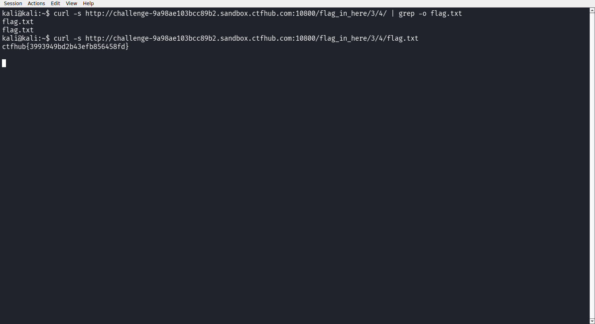

# WP：目录遍历

> **CTFHub 路径**：技能树 → Web → 信息泄露 → 目录遍历
> **任务**：按题目页面提示找到 flag。
> **提示**：注意页面给出的路径和 URL；目录列表本身就是一种信息泄露。只在题目环境内点击和访问，不要使用扫描器扫描其他地址。
> **截图要求**：能看到题目环境地址（或题目名称）、你访问的目录/路径，以及最终的 flag。

---

## 题目信息

| 项目 | 内容 |
| --- | --- |
| 环境地址 | http://challenge-9a98ae103bcc89b2.sandbox.ctfhub.com:10800 |
| Flag | ctfhub{3993949bd2b43efb856458fd} |

## 解题过程

打开靶场首页只有一句「点击开始寻找flag」，点进去后页面把 `flag_in_here/` 目录的内容直接列了出来，说明 Web 服务器开着自动目录列表（autoindex）。我先 `curl` 拉了一次 `/flag_in_here/`，看到下面有 `1/ 2/ 3/ 4/` 四个子目录，进入任意一个又是同样的 `1/ 2/ 3/ 4/`，等于四层组合。手点太慢，我写了个十几行的小脚本，用正则抓页面里的 `href` 逐层往下爬，爬了 22 个目录后在 `/flag_in_here/3/4/` 的列表里看到 `flag.txt`。再请求 `/flag_in_here/3/4/flag.txt` 就拿到了 `ctfhub{3993949bd2b43efb856458fd}`，全程只是不断在 URL 路径上往下走，没有改任何请求头。

## 关键请求/响应

```http
GET /flag_in_here/3/4/ HTTP/1.1
Host: challenge-9a98ae103bcc89b2.sandbox.ctfhub.com:10800

HTTP/1.1 200 OK
Content-Type: text/html; charset=UTF-8

<pre><a href="?C=N;O=D">Name</a> <a href="?C=M;O=A">Last modified</a>
<a href="/flag_in_here/">Parent Directory</a>
<a href="1/">1/</a> <a href="2/">2/</a> <a href="3/">3/</a> <a href="4/">4/</a>
<a href="flag.txt">flag.txt</a></pre>

GET /flag_in_here/3/4/flag.txt HTTP/1.1

HTTP/1.1 200 OK

ctfhub{3993949bd2b43efb856458fd}
```

## 原理与复盘

问题出在 **URL 路径**（请求行里的路径部分）：服务器把目录内容渲染成可点击列表，而且没有限制访问层级，攻击者不用猜文件名就能顺着 `/3/4/` 一路走下去。目录列表泄露的是「文件存在性」信息，一旦目录里有备份文件、源码、配置或本题的 `flag.txt`，等于把入口交出去。服务器应当关掉 `autoindex`，并对敏感目录加访问控制。

---

## 截图



> 可以在这份 WP 中另加过程截图；检查时只看指定图片，额外图片不检查。

