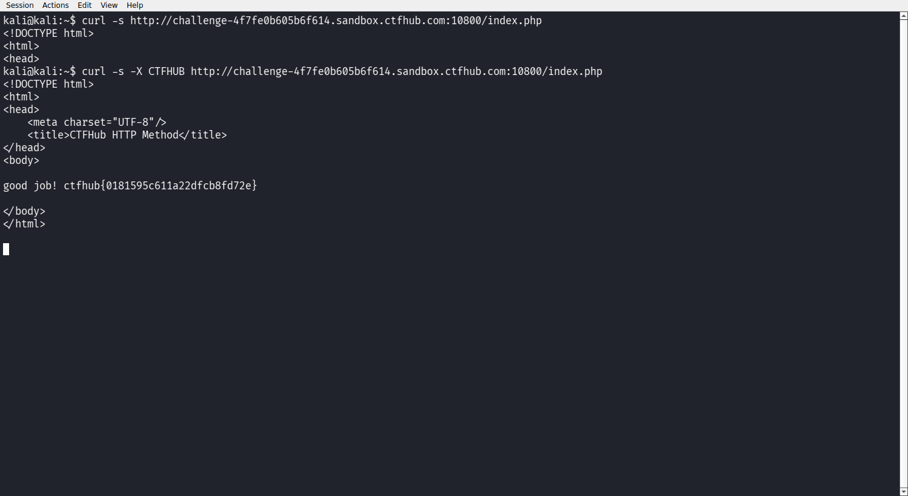

# WP：请求方式

> **CTFHub 路径**：技能树 → Web → Web 前置技能 → HTTP 协议 → 请求方式
> **任务**：按题目要求使用指定的 HTTP 方法访问目标，拿到 flag。
> **提示**：浏览器地址栏默认发送 GET 请求。用 Burp Repeater 修改请求行中的方法，或者用 `curl -X` 复现。
> **截图要求**：优先使用 Burp Repeater，截图中要能看到修改后的请求行（方法 + 路径）和响应中的 flag；如果 Burp 无法启动，可以用 `curl -X` 的方法修改截图代替，并在 WP 中说明原因。只有浏览器普通 GET 访问不算完成。

---

## 题目信息

| 项目 | 内容 |
| --- | --- |
| 环境地址 | http://challenge-4f7fe0b605b6f614.sandbox.ctfhub.com:10800 |
| Flag | ctfhub{0181595c611a22dfcb8fd72e} |

## 解题过程

浏览器地址栏只会发 GET，所以我先在 Kali 终端用 `curl -s .../index.php` 看正常 GET 的结果，返回的是一个普通的 HTML 页面。题目说明里提示「HTTP Method is GET，Use CTF**B Method」，也就是要求把请求行里的方法换成自定义的 `CTFHUB`。浏览器不能改方法，于是我用 `curl -X CTFHUB` 重放同一个请求。响应体里直接返回 `good job! ctfhub{0181595c611a22dfcb8fd72e}`。这说明服务端是拿「请求方法名是否等于 CTFHUB」来判断的，并没有限定只能接受那八个标准方法。

## 关键请求/响应

```http
GET /index.php HTTP/1.1
Host: challenge-4f7fe0b605b6f614.sandbox.ctfhub.com:10800

HTTP/1.1 200 OK
Content-Type: text/html; charset=UTF-8

<html><head><title>CTFHub HTTP Method</title></head><body>
HTTP Method is GET Use CTF**B Method, I will give you flag.
...
------------------------------------------------
CTFHUB /index.php HTTP/1.1
Host: challenge-4f7fe0b605b6f614.sandbox.ctfhub.com:10800

HTTP/1.1 200 OK

good job! ctfhub{0181595c611a22dfcb8fd72e}
```

## 原理与复盘

请求行的格式是「方法 + 请求路径 + HTTP 版本」，方法写在最前面，而浏览器地址栏永远只替用户发 GET，所以必须用 Burp 的 Repeater 或 `curl -X` 才能改。HTTP/1.1 并没有规定服务器只能接受那八个标准方法，本题后端就是按方法名做判断，换个方法名就绕过了按 GET 写的逻辑。

---

## 截图



> 可以在这份 WP 中另加过程截图；检查时只看指定图片，额外图片不检查。

