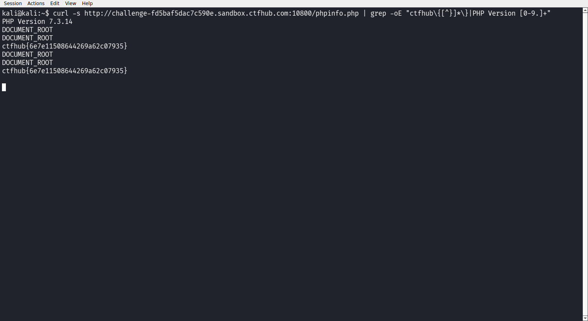

# WP：PHPINFO

> **CTFHub 路径**：技能树 → Web → 信息泄露 → PHPINFO
> **任务**：在 phpinfo 页面中找到 flag，并观察它泄露了哪些信息。
> **提示**：phpinfo 会输出大量 PHP 和服务器配置。用浏览器的查找功能搜索关键字，同时留意页面暴露的路径、版本、环境变量等信息。
> **截图要求**：能看到 phpinfo 页面、你搜索/定位到的 flag，以及至少一处敏感信息。

---

## 题目信息

| 项目 | 内容 |
| --- | --- |
| 环境地址 | http://challenge-fd5baf5dac7c590e.sandbox.ctfhub.com:10800 |
| Flag | ctfhub{6e7e11508644269a62c07935} |

## 解题过程

在 Kali 的 Firefox 里打开靶场首页，页面只有一个标题和「点击查看phpinfo」的按钮，说明真正的信息页并不在 `/`，而是在 `phpinfo.php`。我先用 `curl -i` 请求首页，确认服务器是 openresty + PHP，然后用 `curl -s` 把 `phpinfo.php` 的整页 HTML 抓下来（页面有 80 多 KB）。拿到页面后我没有一行行去翻，而是用 `grep -oE "ctfhub\{[^}]*\}"` 直接在源码里搜 flag，第一次就命中了 `ctfhub{6e7e11508644269a62c07935}`。同一页里还能看到 `PHP Version 7.3.14`、`DOCUMENT_ROOT`、`SERVER_SOFTWARE` 这些字段，属于典型的配置信息泄露。

## 关键请求/响应

```http
GET /phpinfo.php HTTP/1.1
Host: challenge-fd5baf5dac7c590e.sandbox.ctfhub.com:10800

HTTP/1.1 200 OK
Content-Type: text/html; charset=UTF-8
X-Powered-By: PHP/7.3.14

... <title>phpinfo()</title> ...
PHP Version 7.3.14
DOCUMENT_ROOT    /var/www/html
SERVER_SOFTWARE  Apache/2.4.38 (Debian)
...
<h2><a name="module_ctfhub" ...>ctfhub</a></h2>
ctfhub{6e7e11508644269a62c07935}
```

## 原理与复盘

问题不在请求，而在**响应体**：`phpinfo.php` 把 PHP 版本、模块、`DOCUMENT_ROOT`、环境变量等一次性输出给任何一个访问者。攻击者可以据此判断版本对应的已知漏洞、确认站点绝对路径（为文件包含、日志投毒做准备）、拿到管理员邮箱等社工线索。生产环境不应该把 phpinfo 暴露在公网，调试页面用完要删掉。

---

## 截图



> 可以在这份 WP 中另加过程截图；检查时只看指定图片，额外图片不检查。

