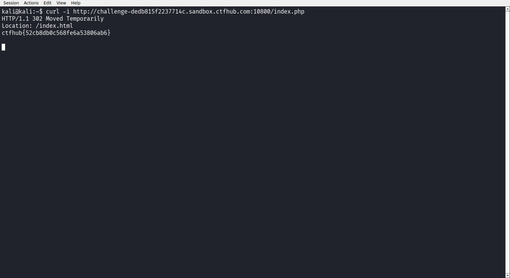

# WP：302 跳转

> **CTFHub 路径**：技能树 → Web → Web 前置技能 → HTTP 协议 → 302 跳转
> **任务**：观察 302 重定向，按题目提示找到 flag。
> **提示**：浏览器通常会自动跟随 302，所以你可能只看到最终页面。打开 DevTools 的 Network 面板（勾选 Preserve log）或 Burp，查看原始响应中的 `302` 状态码和 `Location` 响应头。
> **截图要求**：能看到 302 状态码和/或 `Location` 响应头，以及最终的 flag。只截最终页面、没有 302 证据的截图不合格。

---

## 题目信息

| 项目 | 内容 |
| --- | --- |
| 环境地址 | http://challenge-dedb815f2237714c.sandbox.ctfhub.com:10800 |
| Flag | ctfhub{52cb8db0c568fe6a53806ab6} |

## 解题过程

打开靶场是一个 `index.html`，页面写着「No Flag here!」，只有一个「Give me Flag」的链接指向 `index.php`。在浏览器里点这个链接，地址栏最后又回到了 `index.html`，页面还是那句「No Flag here!」，看不到任何跳转过程，因为浏览器把重定向自动跟随了。我改用 `curl -i` 请求 `index.php`，这次在响应头里清楚地看到 `HTTP/1.1 302` 和 `Location: /index.html`，而**响应体里就是 flag**：`ctfhub{52cb8db0c568fe6a53806ab6}`。也就是说 flag 藏在 302 的响应体里，浏览器一旦跳走就把这段内容丢掉了。

## 关键请求/响应

```http
GET /index.php HTTP/1.1
Host: challenge-dedb815f2237714c.sandbox.ctfhub.com:10800

HTTP/1.1 302 Moved Temporarily
Location: /index.html
Content-Type: text/html; charset=UTF-8
X-Powered-By: PHP/5.6.40

ctfhub{52cb8db0c568fe6a53806ab6}
```

## 原理与复盘

200 表示「成功，本次响应体就是内容」，浏览器直接把响应体渲染出来；302 表示「临时重定向」，浏览器读到 `Location` 就自动再发一次请求去取新地址，原响应的响应体通常会被丢弃。所以看 302 必须用 DevTools 的 Network（勾 Preserve log）、Burp 或 `curl -i` 拦住原始响应，不能只看最终页面。

---

## 截图



> 可以在这份 WP 中另加过程截图；检查时只看指定图片，额外图片不检查。

