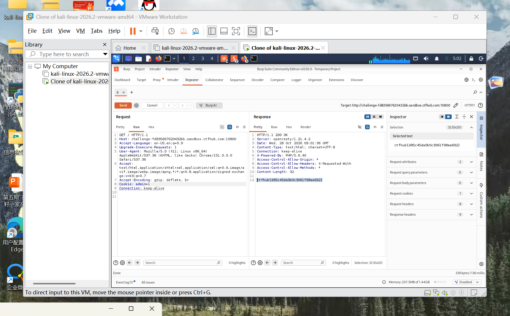

# WP：Cookie

> **CTFHub 路径**：技能树 → Web → Web 前置技能 → HTTP 协议 → Cookie
> **任务**：按题目提示修改 Cookie，拿到 flag。
> **提示**：在 DevTools 的 Application/Storage → Cookies 中查看 Cookie，或在 Burp 的请求头中查看。修改后重放请求，观察页面变化。
> **截图要求**：能看到修改后的 Cookie 请求头，以及服务器返回的 flag 或成功页面。

---

## 题目信息

| 项目 | 内容 |
| --- | --- |
| 环境地址 | http://challenge-fd835667620432bb.sandbox.ctfhub.com:10800 |
| Flag | ctfhub{d85c45da0b0c3061f98aa692} |

## 解题过程

打开靶场首页，返回的是 200，但正文只有一句提示性质的文字，没有 flag，看起来像是「你这个身份不够，看不到东西」。在 Burp 的 HTTP history 里翻这条请求，发现每次请求都自带一个 `Cookie` 请求头，里面有个 `admin` 字段，值是 `0`——服务器是直接拿客户端发来的这个字段判断「你是不是管理员」。既然它信客户端，我就把它改成 `admin=1`：把请求发到 Repeater，在请求头里改完值点 Send。状态码还是 200，响应头也没什么变化，但响应体从提示文字变成了一行 flag（`Content-Length: 32`）。把 flag 填到题目页提交，平台提示正确。

## 关键请求/响应

```http
GET / HTTP/1.1
Host: challenge-fd835667620432bb.sandbox.ctfhub.com:10800
User-Agent: Mozilla/5.0 (X11; Linux x86_64) AppleWebKit/537.36 (KHTML, like Gecko) Chrome/151.0.0.0 Safari/537.36
Accept: text/html,application/xhtml+xml,application/xml;q=0.9,image/avif,image/webp,image/apng,*/*;q=0.8
Accept-Encoding: gzip, deflate, br
Cookie: admin=1
Connection: keep-alive

HTTP/1.1 200 OK
Server: openresty/1.21.4.2
Date: Wed, 28 Oct 2026 09:01:36 GMT
Content-Type: text/html; charset=UTF-8
X-Powered-By: PHP/5.6.40
Access-Control-Allow-Origin: *
Access-Control-Allow-Methods: *
Content-Length: 32

ctfhub{d85c45da0b0c3061f98aa692}
```

## 原理与复盘

Cookie 是放在 HTTP **请求头**里回传给服务器的，浏览器每次访问同一域名都会自动带上，所以身份看起来像是「记住」的，但值本身在客户端，改包工具一改就变。服务器如果只凭 Cookie 里的一个明文字段判断权限，就等于把权限判断交给了用户，这题的 `admin=1` 就是最典型的一例。正确做法是把身份放在服务端的 session 里，Cookie 只存一个随机且经过签名、校验的 session id；同时不要把密码、角色这类敏感信息明文写进 Cookie。

---

## 截图



> 可以在这份 WP 中另加过程截图；检查时只看指定图片，额外图片不检查。
