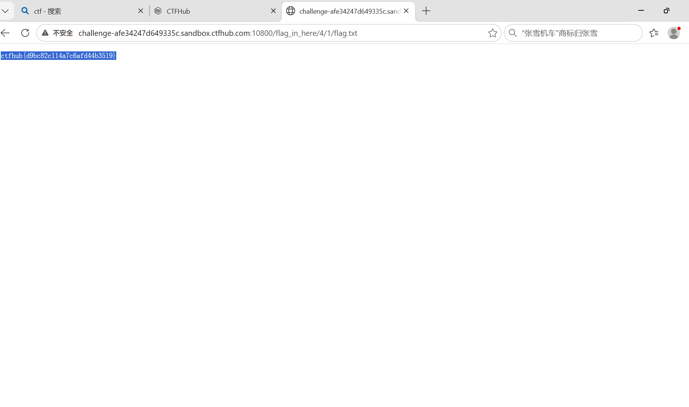

# WP：目录遍历

> **CTFHub 路径**：技能树 → Web → 信息泄露 → 目录遍历
> **任务**：按题目页面提示找到 flag。
> **提示**：注意页面给出的路径和 URL；目录列表本身就是一种信息泄露。只在题目环境内点击和访问，不要使用扫描器扫描其他地址。
> **截图要求**：能看到题目环境地址（或题目名称）、你访问的目录/路径，以及最终的 flag。

---

## 题目信息

| 项目 | 内容 |
| --- | --- |
| 环境地址 | http://challenge-afe34247d649335c.sandbox.ctfhub.com:10800 |
| Flag | ctfhub{d9bc82c114a7c6afd44b3519} |

## 解题过程

开启题目后打开靶场地址，服务器没有返回一个正常的首页，而是直接把目录下的文件名列了出来——这就是题目名里的「目录列表」。列表里有一个 `flag_in_here/` 目录和几个编号目录，我先进了 `flag_in_here/`，发现里面又是两个编号目录 `1/`、`2/`……，看得出这是一棵要靠手点往下走的目录树。我按编号一路点下去，进到 `4/` 再进 `1/`，这个目录里终于出现了一个 `flag.txt`。点开 `flag.txt`，页面正文只有一行，就是 flag，把它填到题目页提交，平台提示正确。整个过程没有发过任何构造的请求，只是在地址栏里顺着 URL 一层层往下访问。

## 关键请求/响应

```http
GET /flag_in_here/4/1/flag.txt HTTP/1.1
Host: challenge-afe34247d649335c.sandbox.ctfhub.com:10800

本题不需要修改请求：全程在浏览器地址栏逐层访问目录，最后直接打开了 flag.txt。
响应体只有一行，就是 flag：
ctfhub{d9bc82c114a7c6afd44b3519}
```

## 原理与复盘

这道题的入口在 URL 的**路径**部分（请求行里的 `GET /…`），逐个目录往下走，路径越拼越长，flag 就藏在某一个具体文件里。根因是 Web 服务器开启了目录索引（Apache 的 `Options +Indexes` 或 Nginx 的 `autoindex on`），没有默认首页时就把整个目录的文件名列出来，等于把站点的文件结构主动告诉访问者。一旦目录里有备份文件、源码、配置或像本题这样的 flag 文件，就能被直接下载下来，所以生产环境应当关闭目录列表，并给每个目录配置默认首页。

---

## 截图



> 可以在这份 WP 中另加过程截图；检查时只看指定图片，额外图片不检查。
