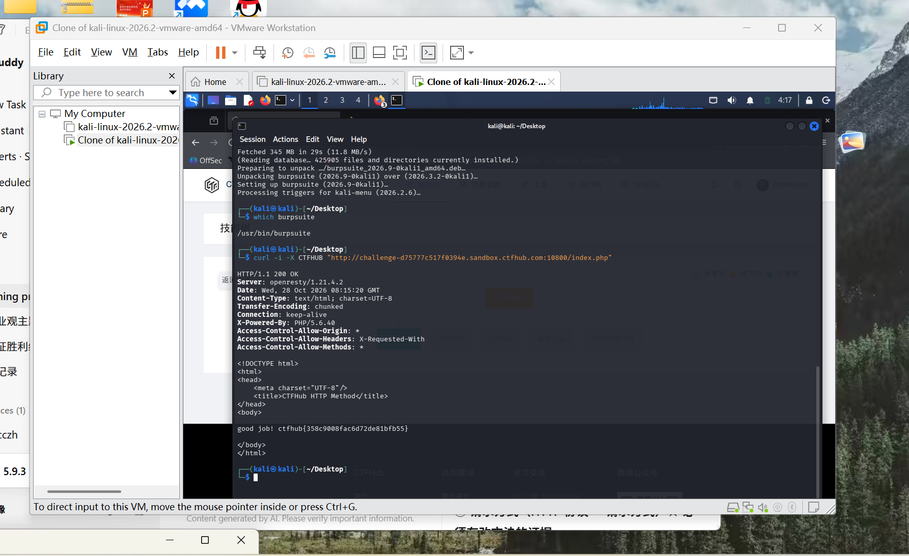

# WP：请求方式

> **CTFHub 路径**：技能树 → Web → Web 前置技能 → HTTP 协议 → 请求方式
> **任务**：按题目要求使用指定的 HTTP 方法访问目标，拿到 flag。
> **提示**：浏览器地址栏默认发送 GET 请求。用 Burp Repeater 修改请求行中的方法，或者用 `curl -X` 复现。
> **截图要求**：优先使用 Burp Repeater，截图中要能看到修改后的请求行（方法 + 路径）和响应中的 flag；如果 Burp 无法启动，可以用 `curl -X` 的方法修改截图代替，并在 WP 中说明原因。只有浏览器普通 GET 访问不算完成。

---

## 题目信息

| 项目 | 内容 |
| --- | --- |
| 环境地址 | http://challenge-d75777c517f0394e.sandbox.ctfhub.com:10800 |
| Flag | ctfhub{358c9008fac6d72de81bfb55} |

## 解题过程

打开靶场地址后，首页先返回 302 跳到 `index.php`，页面正文写着 “HTTP Method is GET, Use CTF**B Method, I will give you flag”，后面还有一句提示：如果遇到 “HTTP Method Not Allowed”，就去请求 `index.php`。也就是说服务器只认 `CTFHUB` 这个方法（`CTF**B` 是打了码的 `CTFHUB`），而浏览器地址栏只会发 GET，直接访问拿不到 flag。我没有在浏览器里硬试，而是按提示在 Kali 终端里用 `curl -X CTFHUB` 向 `/index.php` 发了一次自定义方法的请求。收到的响应是 `HTTP/1.1 200 OK`，响应体里给出了 `good job!` 和 flag。我把 flag 填进 CTFHub 题目页提交，平台提示正确。

## 关键请求/响应

```http
CTFHUB /index.php HTTP/1.1
Host: challenge-d75777c517f0394e.sandbox.ctfhub.com:10800
Accept: */*

HTTP/1.1 200 OK
Server: openresty/1.21.4.2
Content-Type: text/html; charset=UTF-8
X-Powered-By: PHP/5.6.40
Access-Control-Allow-Origin: *

<title>CTFHub HTTP Method</title>
<body>
good job! ctfhub{358c9008fac6d72de81bfb55}
</body>
```

## 原理与复盘

请求行由「方法 + 请求路径 + HTTP 版本」三部分组成，方法就在最前面，服务器是根据它来决定这次请求怎么处理的。只允许 GET 的接口遇到别的方法会返回 405，而这题反过来只认 `CTFHUB`，把请求行里的方法换掉就能拿到 flag。浏览器地址栏只能发 GET，所以这类题必须用 curl 的 `-X` 或 Burp Repeater 自己构造请求行。

---

## 截图



> 可以在这份 WP 中另加过程截图；检查时只看指定图片，额外图片不检查。
