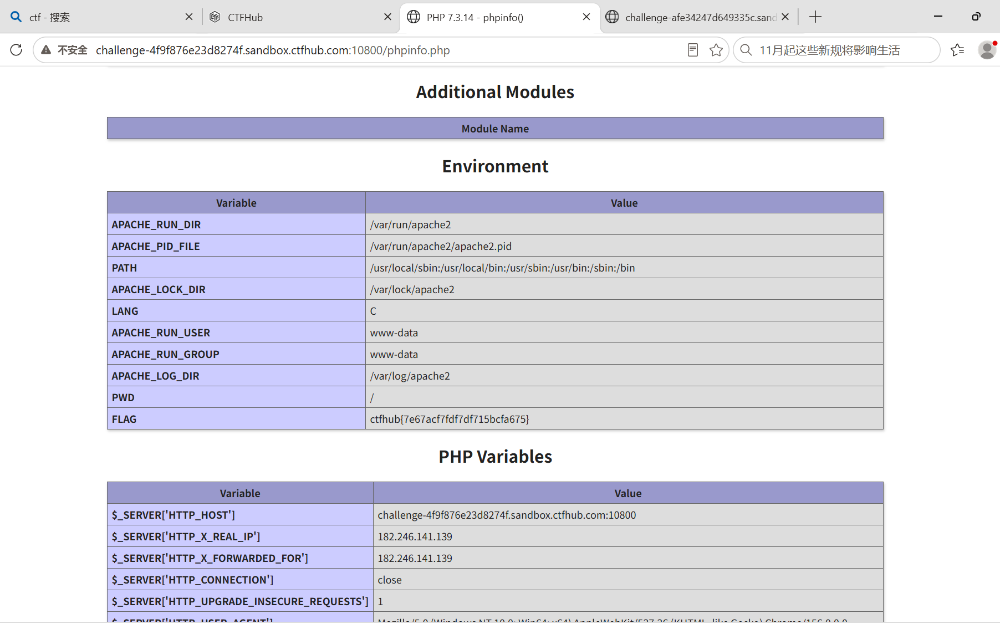

# WP：PHPINFO

> **CTFHub 路径**：技能树 → Web → 信息泄露 → PHPINFO
> **任务**：在 phpinfo 页面中找到 flag，并观察它泄露了哪些信息。
> **提示**：phpinfo 会输出大量 PHP 和服务器配置。用浏览器的查找功能搜索关键字，同时留意页面暴露的路径、版本、环境变量等信息。
> **截图要求**：能看到 phpinfo 页面、你搜索/定位到的 flag，以及至少一处敏感信息。

---

## 题目信息

| 项目 | 内容 |
| --- | --- |
| 环境地址 | http://challenge-4f9f876e23d8274f.sandbox.ctfhub.com:10800 |
| Flag | ctfhub{7e67acf7fdf7df715bcfa675} |

## 解题过程

开启题目后访问 `/phpinfo.php`，页面标题是 `PHP 7.3.14 - phpinfo()`，正文一张接一张的表格，把 PHP 编译参数、模块、Apache 配置、环境变量全列了出来。页面很长，我不可能一行行翻，所以用浏览器的查找功能（`Ctrl+F`）搜关键字 `FLAG`，页面直接定位高亮到了 **Environment** 这一节里名为 `FLAG` 的变量。它的值就是 flag，填到题目页提交后平台提示正确。顺便看了同一节的其他行，能直接读到 `APACHE_RUN_USER`、`APACHE_LOG_DIR`、`PATH` 这些服务器环境信息，下方 PHP Variables 里还暴露了 `$_SERVER["HTTP_HOST"]` 和 `HTTP_X_REAL_IP`（靶场的出口 IP）。

## 关键请求/响应

```http
GET /phpinfo.php HTTP/1.1
Host: challenge-4f9f876e23d8274f.sandbox.ctfhub.com:10800

本题不需要修改请求：直接访问 phpinfo.php，页面里就能看到 flag。

Environment 表中的关键一行：
Variable: FLAG
Value:    ctfhub{7e67acf7fdf7df715bcfa675}
```

## 原理与复盘

泄露点在**响应体**：`phpinfo()` 把服务器内部的运行状态整页打印出来，包括 PHP 版本、Apache 配置、绝对路径、环境变量，本题的 flag 恰好被放进了一个环境变量 `FLAG` 里。这些信息对攻击者非常有价值——版本号可以直接对应到已知漏洞，路径和用户能帮着找上传点或日志位置，`$_SERVER` 里的 IP 能判断是否经过代理。所以 phpinfo 属于典型的「调试接口忘记删」类问题，上线前必须删掉，或者至少限制到内网和指定 IP 访问。

---

## 截图



> 可以在这份 WP 中另加过程截图；检查时只看指定图片，额外图片不检查。
