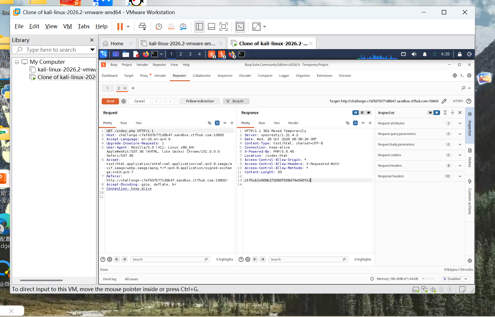

# WP：302 跳转

> **CTFHub 路径**：技能树 → Web → Web 前置技能 → HTTP 协议 → 302 跳转
> **任务**：观察 302 重定向，按题目提示找到 flag。
> **提示**：浏览器通常会自动跟随 302，所以你可能只看到最终页面。打开 DevTools 的 Network 面板（勾选 Preserve log）或 Burp，查看原始响应中的 `302` 状态码和 `Location` 响应头。
> **截图要求**：能看到 302 状态码和/或 `Location` 响应头，以及最终的 flag。只截最终页面、没有 302 证据的截图不合格。

---

## 题目信息

| 项目 | 内容 |
| --- | --- |
| 环境地址 | http://challenge-c7af637b771d8b47.sandbox.ctfhub.com:10800 |
| Flag | ctfhub{e909b272090f558d74e5607e} |

## 解题过程

第一个感受是「页面什么都没给我」：在 Kali 的浏览器里打开靶场地址，地址栏一闪就停在另一个页面上，正文是空的，翻遍页面也找不到 flag。按题目提示打开 Burp 的 Proxy → HTTP history，重新访问一次，才看到真正发生的事：浏览器请求的是 `/index.php`，服务器回的不是 200，而是 `302 Moved Temporarily`，并用 `Location: /index.html` 让浏览器换个地址再去取。浏览器默认会自己跟着跳，所以中间这个 302 的响应体和响应头我根本没看见。我把这条请求发到 Repeater 点了一次 Send，在 Raw 里直接读原始响应，发现 302 的响应体里就写着 flag（`Content-Length: 33`，正好是 flag 的长度）。也就是说这题的 flag 不在最终页面上，而是塞在被浏览器丢掉的那个重定向响应里。把 flag 提交到题目页，平台提示正确。

## 关键请求/响应

```http
GET /index.php HTTP/1.1
Host: challenge-c7af637b771d8b47.sandbox.ctfhub.com:10800
User-Agent: Mozilla/5.0 (X11; Linux x86_64) AppleWebKit/537.36 (KHTML, like Gecko) Chrome/151.0.0.0 Safari/537.36
Accept: text/html,application/xhtml+xml,application/xml;q=0.9,image/avif,image/webp,image/apng,*/*;q=0.8
Accept-Encoding: gzip, deflate, br
Connection: keep-alive

HTTP/1.1 302 Moved Temporarily
Server: openresty/1.21.4.2
Date: Wed, 28 Oct 2026 08:28:26 GMT
Content-Type: text/html; charset=UTF-8
Connection: keep-alive
X-Powered-By: PHP/5.6.40
Location: /index.html
Access-Control-Allow-Origin: *
Access-Control-Allow-Headers: X-Requested-With
Access-Control-Allow-Methods: *
Content-Length: 33

ctfhub{e909b272090f558d74e5607e}
```

## 原理与复盘

302 是临时重定向，位置在响应的状态行，配合 `Location` 响应头一起告诉浏览器「这个资源现在去那个地址拿」。它和 200 在浏览器里的表现完全不同：200 是直接把响应体渲染出来，302 是先跳走，再把新地址的结果给你看，中间那一跳的报文默认不显示。所以判断一次请求到底发生了什么，不能只看页面，要看状态码；用 Burp 或 DevTools 勾上 Preserve log 才能把跳转链完整留下来。这题也提醒我，flag 不一定在「最终页面」上，响应体在哪个环节都可能有东西。

---

## 截图



> 可以在这份 WP 中另加过程截图；检查时只看指定图片，额外图片不检查。
